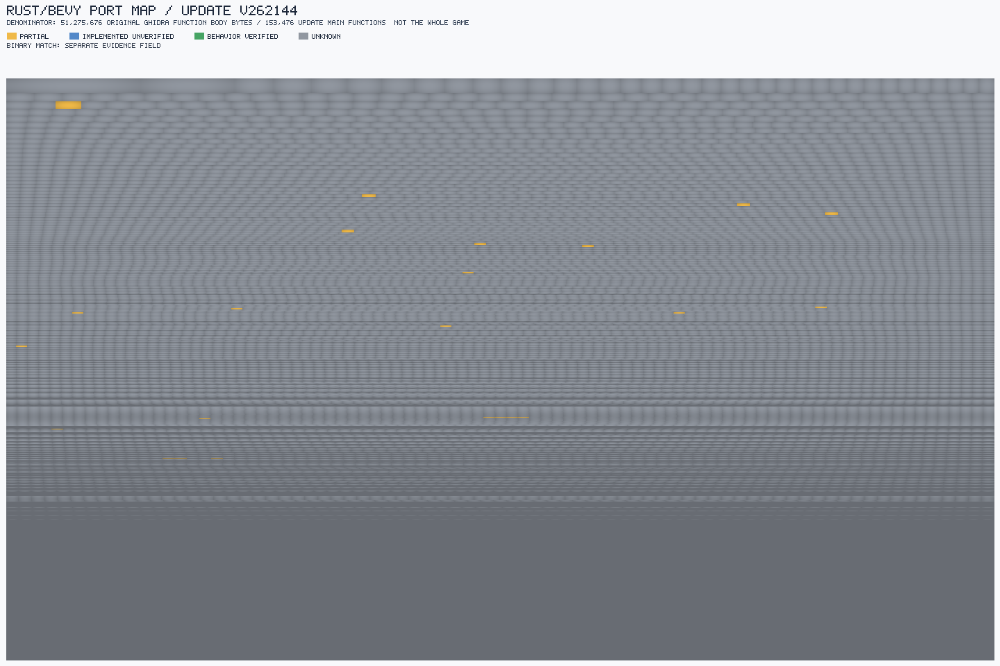
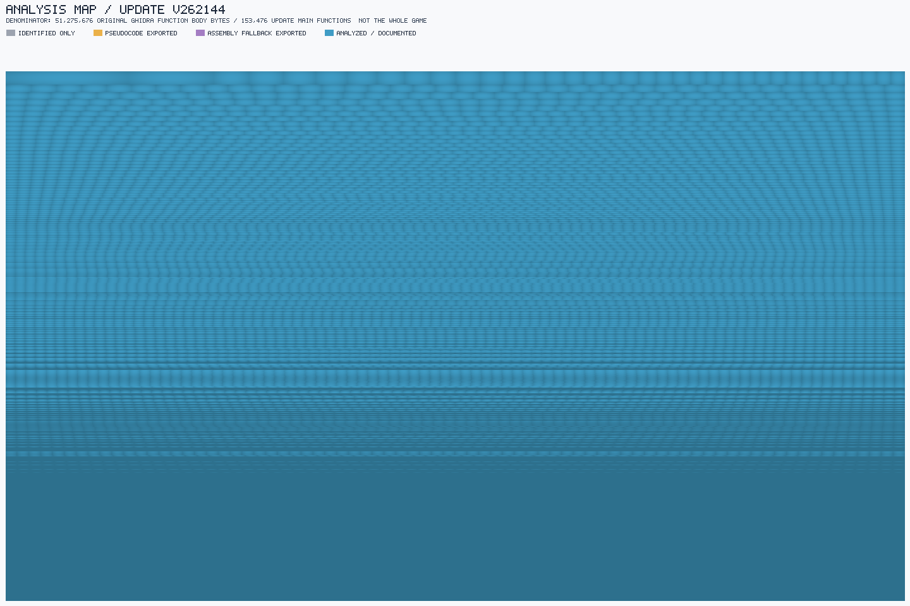

# Pokémon Legends: Arceus — reverse-engineering workspace & Rust/Bevy port

**English** · [Español](README.es.md)

A **The Spreadsheet Method** workspace for reverse-engineering a legally owned
copy of *Pokémon Legends: Arceus* (Nintendo Switch) and driving a Rust/Bevy port
from a versioned sheet book.

> **This repository contains no game content.** No ROMs/NSZ, no extracted
> assets, no decompiled code, no keys. The derived tables and reports it tracks
> contain game-derived ids, numbers and some name strings (audited in
> [`docs/legal-audit.md`](docs/legal-audit.md)). It ships the *method*, the
> *tooling* and the *derived knowledge* (sheets). Every collaborator supplies
> their own copy of the game and their own `prod.keys`, and regenerates the heavy
> artifacts locally — see [`REPRODUCE.md`](REPRODUCE.md).

## Where the project stands

Figures refer to the update v262144 `main` (153,476 located functions). The phase-by-phase detail is in the [Completion plan](#completion-plan). Last updated: 2026-10-17.

### 📊 Progress by phase

<!-- progress-bars:start -->
```text
 1 Extraction                       ████████████████████    100 %   enumerated files and members
 2 Inventory of main                ███████████████████░   98.4 %   executable bytes inside functions
 3 Pseudocode export                ████████████████████    100 %   of the 153,476 located functions
 4 gameDB index                     ████████████████████    100 %   of the exported C files
 5 Data (RomFS)                     ████████████████████    100 %   extracted and overlaid
     · interpretation               ░░░░░░░░░░░░░░░░░░░░    3.0 %   14/466 modified files compared inside
 6 Analysis: read by analysts       █████████████░░░░░░░   66.4 %   101,972 of 153,476 functions
     · classified by program        ███░░░░░░░░░░░░░░░░░   18.4 %   28,308: tiny functions; says what they do, not what they are for
     · copied from identical        ██░░░░░░░░░░░░░░░░░░   14.6 %   22,392: exact copies of an audited function
     · import stubs                 ░░░░░░░░░░░░░░░░░░░░    0.5 %   801: identified from link data
 7 Implementation (port)            ░░░░░░░░░░░░░░░░░░░░   <0.1 %   38 of 153,476 with a partial implementation
 8 Behaviour verification           ░░░░░░░░░░░░░░░░░░░░      0 %   0 of 153,476
 9 Binary matching                  ░░░░░░░░░░░░░░░░░░░░      0 %   0 of 153,476
10 Playable port                    █████████░░░░░░░░░░░    ~45 %   average of qualitative estimates
```

*Bars show what is actually quantified in each phase; several phases have an unknown full denominator (see the Completion plan). Phase 2 measures executable bytes covered by functions, not a function count; in phase 6 only the first line is functions read and understood; the other three are counted separately.*
<!-- progress-bars:end -->

### ✅ Done

- **Extracted material:** base (v0) and update (v262144) available; the five executables (`main`, `rtld`, `sdk`, `subsdk0`, `subsdk1`) extracted and hash-verified; RomFS extracted and overlaid. The update's auxiliary modules are byte-identical to the base's.
- **Game data:** the base + update overlay has 19,095 files (17,904 unchanged, 466 modified, 725 added, 0 removed). Interpreted so far: the base Lua scripts (799 of 800), plus selected tables and texts.
- **`main` functions:** 153,476 located functions, all with exported pseudocode (153,471 in C and 5 in assembly) and indexed in gameDB. After fixing six wrong "never returns" flags, their bodies cover **98.40 %** of the executable code (52,255,468 of 53,106,320 bytes). The remaining 850,852 bytes are classified (padding, tables, data and possible code) but not interpreted ([report](reports/function-progress/d1-main-gap-closure.md)).
- **Third-party code separated:** 36,021 functions (23.47 %) are libraries linked into the program (networking, Havok, Wwise, Nintendo SDK, Lua, Oodle). Game code is at most 117,455 functions ([report](reports/function-progress/d2-library-ownership.md)).
- **Technical findings:** the engine's name hash is 64-bit FNV-1a with its own offset basis (it reproduces 450 of 450 event-flag ids); all 816 library calls resolved; 205,023 missing data pointers applied.
- **Documented functions: 153,473 of 153,476 (99.998 %), in four separate categories:** 801 import stubs, 101,972 complete-body analyst records, 22,392 copies of independently audited EXACT functions and 28,308 deterministic mechanical classifications. These are static operation descriptions, not game-purpose interpretation, types (N2), runtime verification or binary matching. The closing gap round (D4-PAR, decisions `dec302`–`dec303`) documented the remaining unknowns from live-captured bodies with independent audit; body acquisition bypassed the GhidraMCP 120,000-character cap via `force_decompile` and a long-timeout Ghidra script. 3 located functions stay unknown (1 exceeds the decompiler response buffer, 2 return no body). **Names (N1) and typed signatures (N2) are a separate, pending track.** A 10-panel parallel round (2026-10-10, [report](reports/function-progress/n2-nametype-round.md)) tried to name and type all 153,476 from the code and cross-references: names are **not recoverable** from this stripped binary (1,964 labels, almost all library/template; genuine game names are very few), and 111,462 mechanical type drafts were produced — neither is N2. **N2 is now open:** 331 functions have been promoted to N2 (decisions [`dec305`](sheets/decisions.tsv#dec305)–[`dec323`](sheets/decisions.tsv#dec323); see [`function_n2_evidence.tsv`](sheets/re/function_n2_evidence.tsv) and the N2 reports in `reports/function-progress/`); the rest are still pending. [Latest: D4 round-2 panel 1 (decision `dec301`)](reports/function-progress/d4-round2-panel-1-documentation-first.md); [repeatable queue](reports/function-progress/d4-documentation-queue.md).
- **D4 round 2 and the remediation round are integrated; nothing is pushed.** Round 2 (nine panels, decisions `dec290`–`dec297` and `dec301`) appended 86,640 ledger rows and recorded 5,361 gate-withhold subjects; its per-panel reports ([panel 7](reports/function-progress/d4-round2-panel-7-documentation-first.md), [panel 8](reports/function-progress/d4-round2-panel-8-documentation-first.md), [panel 9](reports/function-progress/d4-round2-panel-9-documentation-first.md), [panel 5](reports/function-progress/d4-round2-panel-5-documentation-first.md), [panel 4](reports/function-progress/d4-round2-panel-4-documentation-first.md), [panel 2](reports/function-progress/d4-round2-panel-2-documentation-first.md), [panel 10](reports/function-progress/d4-round2-panel-10-documentation-first.md), [panel 6](reports/function-progress/d4-round2-panel-6-documentation-first.md), [panel 1](reports/function-progress/d4-round2-panel-1-documentation-first.md)) record the counts and disclosures. The remediation round then reworked that withhold surface independently: [1,155 manifest-accepted records](reports/function-progress/d4-remediation-round.md) upgraded to complete-body analyst records against body bytes recomputed on disk (1,154 in place + 1 fresh row filling the `007dd09c` gap), 686 round-2 accepted records that had been skipped by the id-exists rule supplemented in place (an earlier ~334 working expectation was verified and extended to all eight panels), 20 gap addresses recorded as explicit unknowns with their reasons, and 2,354 withheld subjects left untouched without note churn.
- **Identical functions grouped:** 109,550 distinct functions out of 153,476; 53,912 sit in groups of identical copies.
- **Port:** a Rust skeleton that loads and runs real event scripts.

### 🔄 In progress

- Reading the remaining game functions, in order of importance.

### ❌ Missing

- **Understanding the game code:** 66.4 % (101,972 of 153,476 functions) has been individually read by analysts; the rest of what is documented is import stubs, audited copies and mechanical classifications. Static documentation is not N1/N2 (see the Phase 6 row).
- **Fixing wrongly delimited function boundaries.** This would change the 153,476 total and awaits a decision.
- **Regenerating the exported pseudocode,** which is out of date after the fixes.
- **Data:** 452 of the 466 modified files still lack a successful internal comparison, and it is not known which code each data file belongs to.
- **Behaviour verification and binary matching:** 0 of 153,476 functions.
- **Port:** partial (38 functions with a partial implementation; visual, save and system bindings very incomplete).

## The game: base + update

The game ships in two parts:

- **Base** (`pk1.nsz`, v0) — the complete title: every executable module
  (`main`, `rtld`, `sdk`, `subsdk0`, `subsdk1`) and almost all data (the RomFS,
  ~2.3 GB).
- **Update** (`pk2.nsz`, v1.1.1 / v262144) — a **patch**, not a standalone
  program. It carries a complete new `main` plus only the data files it changes
  (an AesCtrEx/BKTR delta).

**The update does not run on its own.** Playing v1.1.1 needs the base **and** the
update; the running game is the **overlay of the two**, and the program code that
executes is the update's `main`, which replaces the base's. The base is therefore
**mandatory** — it supplies everything the update does not ship.

**Port target:** the game as it runs with the update applied (the base + update
overlay) — never "the update", which is not a program. The base's own `main` (v0)
is an older build of the same program and is not ported; it is recorded for
provenance only.

## Completion plan

Phase-by-phase status from the raw game dumps to a playable port. Percentages are
counted from real files and functions within each stated inventory; extraction
percentages apply to the enumerated member/path sets, not an unproven
whole-game denominator. `Unknown` means the complete denominator
for that phase/module is unknown, so no completion percentage is invented; use
`N/A` only when the part does not apply. Known staged-file counts do not
establish complete-module coverage. `~` marks qualitative estimates.

| Phase (PLAN.md) | Part | % done | % left | Note | Methods / tools |
|---|---|:--:|:--:|---|---|
| | Real-time terrain splat material | Unknown | Unknown | **VERIFIED:** `--terrain splat` is the default GPU path; it keeps the 8 decoded layers sharp near the camera, uses triplanar projection on slopes, and fades to the baked macro colour at distance. `--terrain bake` remains the fallback. The same 1920×1080 automation cameras were inspected for areas 00–05: no visible chunk seams, stretched cliff textures, obvious far tiling, or colour jump. Performance and assumptions are recorded in [terrain albedo](reports/data-progress/terrain_albedo.md). | `game/terrain_splat.rs`, `game/terrain_splat.wgsl`, automation captures |
| 1. Extract (P0) | Base: ExeFS + RomFS | 100 % | 0 % | | `.tools/` extraction pipeline; NSO parsing; SHA-256 and segment-hash checks |
| | Update: `main` + data | 100 % | 0 % | | `.tools/` extraction pipeline; NCZ/ExeFS/RomFS manifests; hash checks |
| | Update modules (`rtld`, `sdk`, `subsdk0/1`) | 100 % | 0 % | extracted + NSO-verified; byte-identical to the base's | NSO extraction plus byte/hash comparison against base modules |
| 2. Inventory (P0) | `main` update | Unknown | Unknown | The 153,476 inventoried functions match the Ghidra project's FunctionManager exactly. In the working copy, after fixing six wrong "never returns" flags (D1), the body union is 52,255,468 / 53,106,320 bytes (98.40 %); the original fix2 reference was 51,275,676 (96.55287 %). 850,852 bytes remain outside every body and are classified in the [D1 report](reports/function-progress/d1-main-gap-closure.md). The complete valid-function denominator remains unknown ([range reconciliation](reports/function-progress/p0-update-main-ghidra-range-reconciliation.md), [gap classification](reports/function-progress/p0-update-main-gap-classification.md)) | Ghidra body-range reconciliation, listing-state classification and correction of "never returns" flags |
| | `main` base | Unknown | Unknown | 68,412 historical capped detections, not a complete denominator. Provenance qualified (15/15 NSO segment hashes); base `main` is port provenance only. | Direct NSO metadata parser; module IDs, SHA-256 and segment-hash verification |
| | `sdk` / `subsdk0` / `subsdk1` / `rtld` | Unknown | Unknown | Exact existing-body unions / `.text` bytes / gaps: `rtld` 5,220/6,240; gap 1,020/13 ranges; `sdk` 1,167,456/5,822,640; gap 4,655,184/11,529; `subsdk0` 1,746,372/3,445,104; gap 1,698,732/2,268; `subsdk1` 5,016,388/6,298,960; gap 1,282,572/3,210. These reconcile existing detections only, not complete function coverage. Inventory completeness and complete export denominators are unknown; the gameDB index of the available C corpus is complete ([range reconciliation](reports/function-progress/p0-auxiliary-range-reconciliation.md)) | Direct Ghidra body-range unions and gap listing classes; inventory entry-ID check; completeness not established |
| 3. Pseudocode export (prep) | `main` update | 100% of located inventory | 0% of located inventory | All 153,476 inventoried functions have outputs (153,471 C + 5 ASM); separately, the exact body union in the fix2 manifest (original inventory) is 96.55287% of executable bytes (the D1 working copy reaches 98.40 %, see Phase 2), with 3.44713% outside existing bodies. Corrected `getCodeUnitContaining` query classifies the 13,897 outside-body seeds as 77 in defined instructions (308 bytes), 13,820 in defined data (13,820 bytes), 0 undefined and 0 unmapped; 91 targets / 179 incoming edges (CALL 8/11; JUMP class 64/66, conditionality combined; other flow 0/0; non-flow 19/102). Listing/reference metadata does not establish semantics, reachability, function boundaries or function existence. The prior `getCodeUnitAt` result misclassified inside-unit addresses as undefined; the earlier jump subtype split is superseded/unconfirmed. Interpretation of the residual and candidate-function validity are **Deferred beyond P0**, not P0 tasks or exit gates ([residual audit](reports/function-progress/p0-update-main-residual-export.md), [ranges](reports/function-progress/p0-update-main-ghidra-range-reconciliation.md), [gap classification](reports/function-progress/p0-update-main-gap-classification.md), [flow triage](reports/function-progress/p0-update-main-gap-flow-triage.md), [correction evidence](reports/function-progress/p0-update-main-gap-flow-triage-correction.md)) | Fix2 Ghidra inventory/export; C/ASM fallback; direct body-range reconciliation and listing-state/reference-metadata triage |
| | `main` base | 5.8 % | 94.2 % | 3,997 of 68,412 | Ghidra export pipeline; bounded by the current base inventory |
| | `sdk` / `subsdk0` / `subsdk1` / `rtld` | Unknown | Unknown | 20,327 C exports / 7,902,740 summed body bytes; 50.75% of 15,572,944 `.text` bytes is a measured body-size ratio, not coverage; complete function denominator unknown ([report](reports/function-progress/p0-auxiliary-module-export-inventory.md)) | Ghidra 12.1.2 C pseudocode export; body-size aggregation; not a coverage percentage |
| 4. Index (gameDB) (prep) | `main` update | 100 % | 0 % | All 153,471 available staged C files indexed; 152,634 parsed function rows, 837 files without a parsed function row; 5 ASM fallbacks are outside this C-only corpus. This is staged-export indexing, not semantic coverage ([global index report](reports/function-progress/p0-global-gamedb-index.md)) | gameDB SQLite index; read-only indexed-vs-export parity checks |
| | `main` base | 5.8 % | 94.2 % | Current partial export/index: 3,997 files, 3,917 parsed function rows, 80 without a parsed row; percentage remains bounded by 3,997 / 68,412 inventoried functions ([global index report](reports/function-progress/p0-global-gamedb-index.md)) | gameDB SQLite index bounded by the partial base pseudocode export |
| | `sdk` / `subsdk0` / `subsdk1` / `rtld` | Unknown | Unknown | All currently available staged C files indexed: 20,327 files / 20,116 parsed function rows / 211 without parsed rows (`rtld` 31/31/0; `sdk` 9,063/9,002/61; `subsdk0` 2,959/2,901/58; `subsdk1` 8,274/8,182/92; each triplet is files/rows/no-row files). Complete module function denominators are unknown, so module-completion percentages remain Unknown ([global index report](reports/function-progress/p0-global-gamedb-index.md)) | gameDB SQLite index; current-export counts only, not complete-module coverage |
| 5. Data (RomFS) (P0) | Base Lua scripts | 99.9 % | 0.1 % | 799 of 800 | RomFS extraction; Lua parsing and per-file validation |
| | Effective base + update overlay | 100 % | 0 % | **Overlay arithmetic only:** 19,095 virtual entries (17,904 unchanged / 466 modified / 725 added / 0 removed). Structural comparisons: 14/466 modified successful (SARC 10/10; GFLXPACK 4/10); 452/466 still lack successful internal comparison. Message: 376 changed + 320 added files; 189 complete pairs, 179 fully accepted / 10 partial; `.dat` 378/378 and `.tbl` 368/378 accepted. `.blua` compile: 96/108 accepted, 12 rejected (all 108 headers Lua 5.3; chunks not called). Event-progress `.bin`: 68/90 accepted, 22 unsupported; parser has no magic signature. Added hashes: 33/725 exact base matches, 692/725 no exact match; nonmatches do not prove newness. **Semantic ownership unknown for 1,191/1,191 delta entries.** | Hash-verified manifest; format-specific structural parsers only; aggregate file hashing; see [overlay audit/addendum](reports/function-progress/p0-overlay-ownership.md), [message tables](reports/function-progress/p0-message-table-overlay-audit.md), [AHTB](reports/function-progress/p0-ahtb-overlay-reinspection.md), [GFLXPACK](reports/function-progress/p0-gfpak-variant-followup.md), [Lua](reports/function-progress/p0-blua-overlay-compile-audit.md), [event tables](reports/function-progress/p0-event-table-overlay-audit.md), and [local internal audit](reports/function-progress/p0-overlay-local-internal-audit.md) |
| | SARC packages | Unknown | Unknown | Base-only index: 257 SARC archives and 3,416 nested children; the effective base+update denominator and semantics are unknown. Nested children are not added to the 19,095 outer paths. | SARC parser/indexer; total denominator not established |
| | Strings / references | Unknown | Unknown | 13,370 + 29,162, no total | Extraction/reference scanners; total denominator not established |
| | Domain tables | Unknown | Unknown | 12 sheets in `sheets/domain` only, no total; the `data` tables are tracked in the rows below | TSV/sheet ingestion and `sheetty` preflight |
| | PML core tables | 100 % of PML scope | 0 % | 5 data tables decoded (personal, grow_table, evolution, moves, learnsets; 29,033 total rows); see [report](reports/data-progress/pml_tables_extraction.md) | Python decoders (`.tools/decode_pml_tables.py`) and integrity validator (`.tools/validate_pml_tables.py`) |
| | National Pokédex models (user collection) | ~71 % of species | ~29 % of species | Data layer (previous work): 1,025 national species/forms under `data/national`. **Mapping:** the user's 1,690 model `.blend` files (1,582 distinct packs, read-only) are numbered by the games' internal model index, NOT the national number above 649 (VERIFIED against the in-game PLA catalog: `pm0749` = Bergmite #712, `pm0763` = Goomy #704, `pm0841` = Rowlet #722; 226 species anchored). `data/national/model_map.tsv` (`.tools/build_model_map.py`) maps 1,127 rows (845 VERIFIED + 282 PROBABLE, each with its icon or catalog reason); 727 of 1,025 species have a model and 563 rows stay DESCONOCIDO (no in-repo table for the 650+ blocks). Form conventions verified: `VV=01` rare/shiny (`_col_rare` textures), `VV=11` Alolan (the exact 16-form list plus icon), `VV=31` Galarian, `VV=41` Hisuian (PLA catalog), `VV=51` Paldean (Tauros, Wooper); `FF=51/52` Mega X/Y (Charizard, Garchomp icons), `FF=81/82` Gigamax (the 33 `_81` packs are exactly the Gigamax list), `FF=11+n` game form n (PLA catalog). **Conversion:** `.tools/blender_export_pokemon.py` writes one glTF per pack (mesh, skeleton, textures, clips renamed to the engine's `<pack>_NNNNN_<suffix>` scheme; base colour baked from each material's Trinity layer colours `BaseColorLayer1..4` x `_lym` channels, the same formula as the PLA exporter); `.tools/convert_national_batch.py` converted **1,092 packs, 1,092 ok, 0 failed, 3.18 GB** into `work/cache/pokemon_national/` (git-ignored), listed in `data/national/model_export_index.tsv` (82 bones / 33 clips on average, full totals recorded inside). The batch keeps the 12 clip suffixes the engine looks up (`--clips all` regenerates every action: 21 MB / 55 s per model versus 3.5 MB / 7 s); the six pilot packs keep all 40-58 clips. **In game:** `game::pokemon_resource::resolve_model` keeps the game's own catalog first and falls back to the converted models; a wild battle against a national-only species (Skeledirge, pack `pm1015_00_00`) renders the converted model in the arena, the national Pokédex (Y) draws the selected species' real model inside the panel slot (`game::dex_model_preview`), and `--spawn-species N[:forma]` (+ `--spawn-clip`, `--spawn-dist`, `--spawn-cycle`) places one in front of the player (documented in `docs/GUIA-DE-PRUEBAS.md` 2.19). Evidence: screenshots looked at one by one (Charizard, Mega Charizard X, Alolan Raichu, Garchomp, Rowlet, Skeledirge, Zubat, Beedrill; Pokédex Bulbasaur; wild Skeledirge battle), 1,258 lib tests, 17 `port_viewer` tests, 62/62 smoke. Limits: flat baked colour (no layer/emission shaders), 12 clips per batch model, 298 species without a mapped model, and the models' pose/fidelity is not checked by the maintainer. | `.tools/build_model_map.py`, `.tools/blender_export_pokemon.py`, `.tools/convert_national_batch.py`, `.tools/build_national_export_index.py` |
| | Pokémon variant and rare-material data | Unknown | Unknown | 61 app-config rows decoded (5 rare, 56 size categories; source evidence is explicit and bounded). The 356-pack model index records 351 packs with authored rare-material names; a bounded Pikachu rare export produces 10 clips and 9 distinct textures without overwriting normal exports. Rare palette (2026-10-15): the try counts of `pokemon_rare.bin` are VERIFIED as values AND as the parameters the shipped code looks up (FNV-1a 64 of the names in `FUN_00f94470`/`FUN_01b1aa88`): charm +3, research 10 +1, perfect +2, effect distance 35 m, sound frame 150. The `N/4096` base and the event bonuses (+25 standard outbreak, +12 massive) are PROBABLE (external player notes; the 25 and 12 are decoded values). `game/rare_palette.rs` rolls it at spawn time (research bonuses live, charm wired, rare model used when the cache has one); full-game coverage remains Unknown ([reports](reports/data-progress/pokemon_variants.md), [alpha/shiny report](reports/data-progress/alpha_shiny_outbreaks.md), [batch report](reports/data-progress/pokemon_batch.md)) **Model catalog (2026-10-14):** `bin/pokemon/table/poke_resource_table.trpmcatalog` decoded into `data/pokemon_resource_table.tsv` (376 species/form/female → model pack rows; raw layout VERIFIED, female flag PROBABLE). Pack names are not `pm<dex>_<form>_00`: regional forms use `_41`, multi-form species start at `_11`, species after #649 use developer numbers (Rowlet #722 = `pm0841`). With it every wild spawn slot of areas 01-05 resolves to an exported model; before, 204 slots (22 in area 01) stayed grey placeholder spheres. | `.tools/decode_pokemon_variants.py`; `pokemon_batch_export --rare` |
| | Asset batch export | Unknown | Unknown | BNTX textures exported to PNG: 2,966/2,966 in the Task B1 batch, 2,969 PNGs in the retained [texture index](data/texture_index.tsv) (BC5 Z reconstruction is an unverified assumption). The glTF 2 batch exported 153 models (58 static, 95 skinned) and blocked 128 for measured reasons: 59 missing/duplicate skin channel, 38 empty collision stubs, 19 LOD stride mismatches, 9 textures not packed beside the model, 2 multi-buffer layouts, 1 bind residual. Only 10 static models were rendered offscreen and looked at (recognisable objects; some faces render black, a material/texture gap) and one skinned model with one animation was exported and rendered offscreen (the sample frame is cropped/too close; the animation over time is not demonstrated). Pikachu (`pm0025_00_00.gfpak`) assembles and its mapping test passes, and the earlier `base_rgb_overlays`, weighted-sum and sequential-lerp colour hypotheses were rejected; colour is now baked from the TRMTR layer masks (layer-mask channels R,G,B,A weight `BaseColorLayer1..4`, remaining weight keeps the albedo, UV V flipped; see the [colour report](reports/data-progress/pokemon_color.md)). Rest skinning matches source within 2.3e-6 m (joint/IBM residual ≤4.1e-7); tail and parent scales are unit. The tail is not an exporter defect: tail geometry is a thin sheet, skinning is verified in numpy, and the idle clip holds `tail_01` ~43 degrees from rest (InitData is not applied, so the idle pose's authenticity is unproven); the tail looked fine in side/three-quarter renders and in the in-game screenshot `work/cache/game_demo/03_battle_move_selection.png`. Approximate assembled height is 0.5133 m versus ~0.4 m expected; global scale is unproven. `walk01_loop` parses/exports 123 channels and frames 0/15/30 differ; InitData parses as `is_init=1`, unit scale, identity rotation, translation z=-0.01, but its semantics are unknown and it is not applied. Clefairy (`pm0035`) assembled (12 meshes, 44 binds, 54 clips), and Vulpix (`pm0037`) assembled (15 shapes, 60/60 binds) and shows a characteristic tail fan. Pikachu's tail is not shown to be wrong (idle pose plus framing, authenticity of the idle pose unproven), while ear tips are now black; the 10-pack batch was NOT run ([Pokémon assembly report](reports/data-progress/pokemon_model_assembly.md)). A resumable batch exporter ([report](reports/data-progress/pokemon_batch.md), [index](data/pokemon_model_export_index.tsv)) exported all 356 `pm*.gfpak` packs to glTF with colours baked from the TRMTR layer masks: 356 exported (353 with idle+walk+battle clips, 2 with one clip, 1 static-only) and 0 blocked (Brief 19: `pm0570_00_41` recovered skinned through its shape-declared 68-byte stride, `pm0628_00_41` recovered static because its bind pose disagrees with the rest pose; follow-up 2026-10-15: the 9 packs that fell back to static are now skinned with 10 clips each — authored bind records are kept within a 1e-3 residual or rebuilt from the reference rest pose, and the rest render matches the static mesh); 12 were rendered offscreen and looked at with flat unlit colour: recognisable real colours (Pikachu yellow with red cheeks, black ear tips and brown back stripes; Snorlax teal/cream; Gengar purple; Magikarp orange). The 12 looked-at models are Pikachu, Clefairy, Vulpix, Snorlax, Gyarados, Gengar, Munchlax, Rhyperior, Sneasel, Magikarp, Togekiss and one more; the other 342 exported models were not individually checked. The colour layers are decoded and baked as flat colour only: there is no lighting or shader, and emission, roughness and AO are not applied, so this is not shader/lighting fidelity. The Pikachu tail is not an exporter defect (it is the idle pose plus framing; idle-pose authenticity unproven) no Pokémon pack stays blocked (all 356 are exported; `pm0407_01_00` is the single static-only pack: its `defaultwait` clip declares duplicate track names). `pm0025_00_00` and `pm0026_00_00` are covered by the skinned-export regression guard (`crates/pla/tests/model_export_guard.rs`). The rest of the exported models are not visually checked and no animation fidelity is verified; 1,521 of the 1,522 indexed animations have no standalone model association (blocked). The [asset index](data/asset_export_index.tsv) lists 5,790 inputs (3,620 `ok`, 2,170 `blocked`); 78 unresolved model links are listed. The field scenery batch exported 834 of 841 field/terrain models to glTF and blocked 7 (24-byte empty placeholders with no declared shapes; the 208 recovered models include 149 previously blocked for missing/duplicate skin channels, now exported static; see [blocked models report](reports/data-progress/blocked_models.md)) (see the [zone models report](reports/data-progress/zone_models.md) for the reasons histogram and the [field model index](data/field_model_export_index.tsv)); Grey houses diagnosed: the exporter bound the first TRMTR block's albedo to the whole mesh, so the 179 multi-material models (124 with different textures per part) showed one wrong texture; the glTFs are now split per submesh (one material each, by `AppliedMaterial` name), all 956 referenced albedos exist in their packs and decode, and no field material has layer colours or a mask (0/956). A 16-model contact sheet (12 multi-material houses/props plus 4 single-material controls) was rendered headless in Blender with flat texture colour and looked at: the 12 now show coloured roofs and walls and the 4 controls are unchanged. 13 water planes still have no albedo (shader `Water`; 5 other `Water` models, 3 of them in Jubilife, use an all-white albedo), and 62 meshes carry an unexplained vertex attribute that is not exported. No lighting/shader fidelity is claimed. Whole-RomFS denominator remains unknown. See [Task B report](reports/data-progress/serial_assets_export.md), [asset index](data/asset_export_index.tsv), and [unresolved links](data/unresolved_model_links.tsv). | BNTX decoder/PNG exporter; glTF 2 writer, `export_tr_gltf_batch`, headless `verify_gltf_headless` and `export_and_verify_skinned` examples; Bevy `mesh_spike` preview
| | Interface (UI) textures and layouts | Unknown | Unknown | Textures: 6,495 of 6,496 exported to PNG (1,864/1,864 standalone `bin/appli` BNTX; 4,631 more from the layout archives and the 11 base/`_eng` screen packs in `bin/archive/appli`, where the battle menu, battle HUD, field HUD, pause menu, Pokédex and map live); 1 failure (a corrupt archive copy in the patched RomFS). Layouts: Ui2D `bflyt`/`bflan` v9 inside SARC `.arc` plus FlatBuffers `_lyt.bin` manifests; 770 layouts, 18,787 panes and 3,683 animations decoded, no errors outside that archive; 18 layouts redrawn offscreen as a check (battle menu and HUD, summary, Pokédex, field HUD and map look like the game; list screens need runtime data). Text is never decoded; outputs stay in `work/ui/` ([report](reports/data-progress/ui_layouts.md)). In game the original UI is the default (`--ui debug` forces the provisional one): 17 of the 17 layouts the port loads are drawn and bound to the live game state (battle: player and floating opponent plates, action order, Fight/Items/Pokémon/Run diamond, move/item/party rows, message band; field HUD; 16-row pause menu; graphics settings (the game's own options list, one row per option of the current page, slider rows on the game's gauge); the party screen opens an operations submenu (Summary, Move up / Move down, Send to box, Release asked twice) that runs the validated `game::party_ops` operations, and wild encounters now follow the creature's own reaction (`wild_behavior::encounter_intent`: a hidden player is ignored, alerted / chasing / attacking creatures engage); party and summary; bag; boxes; Pokédex; world map behind the area map with the current area highlight; crafting (the game's `making` screen: recipes on its own 5 x 4 slot circles with product icons, material rows with required / owned counts and the game's not-enough state, the info panel and the message strip); the shop (the game's `shop_buy_00` screen: the tab's items on its own 7 x 3 slot circles with icon, label and owned count, Buy / Sell heading, the money plate and the item's price / trade-total panel; the raw shop id stays debug-only); bag, boxes, Pokédex and map remain partly bound: some grid placement, port-owned text and placeholder icons are approximate or UNKNOWN); text is the port's own. The provisional Pokédex (Brief 43) also shows the player research rank, each caught species' research level and points and the selected species' decoded research-task list (`data/dex_tasks.tsv`, 1611 tasks over 242 species; catches and the moves the party uses feed the counters; the rank ladder now carries rank 1 = 500 read from the binary, each step is worth its task's field14+field15 (10 standard, 20 driven, 100 for Arceus) and a species' 100th research point adds a one-time 100-point rank bonus). **VERIFIED:** external port evidence is a 24/24 PNG inventory in `/home/nico/work/capturas_ui2/`, covering pause, party, summary, bag, boxes, Pokédex, map and battle at 1280×720, 1920×1080 and 2560×1440; the retry was windowless GPU, had no audio and exited cleanly. The populated bag visibly uses a placeholder icon for the selected item and shows `Item #169`; IDs 17 and 1710 are VERIFIED by command/state only. Boxes visibly show `Box 1 / 32` with 4 stored Pokémon. Battle visibly shows Bidoof Lv. 5, the Pikachu HUD, the command wheel and the move list. **PROBABLE:** local visual interpretation remains partial. This is port evidence only; it does not establish native visual parity or binary matching. Missing local data falls back to the provisional UI with one message | `ui_export` example; `.tools/ui_layout_decode.py`, `ui_layout_render.py`, `ui_contact_sheets.py`; `game::orig_ui` (runtime renderer); installer step `ui` |
| | Player character model | Unknown | Unknown | Both player variants (p1, p2) export as one skinned glTF each from default outfit parts picked by name (the dress-up tables carry no default flag; face, eyebrows, hair, full-body dress, sandals, bag; 26/32 primitives) on one merged skeleton (base biped 74 rigs + face/hair/clothes extension skeletons at rig offsets 74/125/147, IK records ignored) with 9 clips (idle, walk, run, dash, jump, land, swim; 17 since Brief 22 with the dodge rolls and the crouch) taken from `pc.gfpak` through a recovered FNV directory state. Rendered offscreen and looked at (recognisable uniform, face, hair shape, scarf, boots, bag; walk frame plausible). Height about 1.46-1.49 m, origin at the feet, facing +Z. Hair/eyebrow/eye colour: the 15 hair names (`hair_color_01` darkbrown first) and 14 eye names exist in the tables but NO RGB values were found in the data, so the export tints the grey hair/eyebrow/eye albedo with ASSUMED colours (dark brown p1, light brown p2; options `--hair-color`/`--eye-color`; the eye texture is baked per pixel with the iris mask (G channel of `eye_msk`); sclera and highlight stay white (evidence: `eye_msk` channels, emission texture); default iris colour blue-grey (88,118,150) ASSUMED because the data only has colour names, emission gain 1.0 and iris share 0.5 ASSUMED; checked by one Blender close-up render only (not in the game viewer), compared by eye, not pixel-verified; the dirty/dark skin look in the maintainer's screenshot did not appear in the exported model (it may come from the viewer lighting)); NOT resolved: the real RGB palette, skin tone is a hypothesis (first row of `skin_color_table.bin`), default outfit not proven to be the game start outfit, walk/run clips carry root motion, hair/skirt/sleeve bones are not animated, no IK/expressions, NOT yet used in the viewer (the player is still a capsule), no shader fidelity; trainers not exported ([report](reports/data-progress/player_model.md), [index](data/player_model_export_index.tsv)). WIRED INTO THE VIEWER (`game::player_anim`, `port_viewer`): the avatar loads `work/cache/player/p1_default/player.gltf` (`--player-variant p1|p2`, capsule fallback if missing), with idle/walk/run/dash clips chosen by speed and the walk/run root motion pinned; wiring checked by unit tests and compilation only, NOT visually verified by the maintainer (no viewer run during the merge). **Dress-up (Brief 36):** the decoded catalogue (`data/player_parts_catalog.tsv`, `.tools/dressup_catalog.py`) has 134 pieces (p1 66, p2 68) over 10 slots; `player_export --catalog` writes one self-contained glTF per piece (`<cache>/player/parts/...`, all 134 ok) over the shared biped base plus the canonical extension skeletons each piece skins to, with the 17 body clips and the 12 REAL face clips of `pc/dressup_motion.gfpak` (`face_01..face_11`, `eye_close`); hair (15) and eyebrow (15) and iris (14) colour variants are baked as PNGs listed in each piece's `colors.tsv`, skin tones (4 VERIFIED sRGB rows) ride on the glTF `baseColorFactor`. Runtime `game/dressup.rs` spawns one scene per worn piece (each with its own `AnimationPlayer`, all driven in sync, root motion pinned per scene), swaps hair/eyebrow/eye textures and multiplies the skin tone (plain and toon materials); the look is a separate `look_` section of the save, **format v10** (v9→v10 migration: a v1-v9 file loads the p1 default look); the customization screen (Esc → Customize, 13 rows, live preview with a front camera) is the port's provisional UI — the original dress-up layout (`bin/appli/dressup` → `work/ui/layouts/dressup.json`) is decoded but NOT bound yet. **Expressions (Brief 22):** the real face clips are played on the face piece; the name→clip mapping is classified from each clip's measured bone movement (PROBABLE/SUPUESTO per row, the data has no name mapping); decoded triggers: hiding → serious, battle won/lost → rejoice/trouble with the decoded keep frames. Clothing colour/pattern variants (the row index → texture mapping) remain UNKNOWN. Verified windowless: 62/62 smoke, 1,110 lib tests, startup guard, GPU captures of 5 looks in `work/capturas_personaliz/`; NOT verified by the maintainer's own eyes ([report](reports/data-progress/player_dressup.md), [catalogue](data/player_parts_catalog.tsv), [index](data/player_parts_index.tsv)). | `player_export` example, `player_model`/`dressup`/`face_expr` modules, `render_player_sheet.py`, `.tools/dressup_catalog.py` |
| | Wormhole config values (one file) | 100% of 37 source values | 0% of 37 source values | All 37 non-empty values from `field_wormhole_config.bin` exported with exact key/index/text match; this is not distortion-wave or drop-table coverage ([report](reports/data-progress/world_tables_extraction.md)) | Python FlatBuffer app-config parser; exact source tuple-set validation |
| | Item tables (PLA v262144) | Unknown | Unknown | 1,830 raw item-hash records and 126 raw row-table layouts across six app-config files exported; 1,829 English item-name entries tested against visible-name, AHTB-key and internal-ID FNV candidates with 0 joins. Hash derivation and shop/craft semantics remain unknown; this bounded set is not a semantic denominator. **Item records (new):** `data/item_effects.tsv` decodes the 806 item ids that have a record in `item.dat` (807 records of 0x3c bytes) into 76 columns; 50/50 table cross-checks pass (healing amounts, status cures, revives, PP restore, vitamins, X items, ball prices and categories, stack limit) plus 17/17 agreement with the game's own item descriptions read locally. 32 columns are verified, 16 likely and 28 raw (unused). **Crafting data (new):** 43 `MakeListEntry` rows are decoded with 127/127 referenced numeric IDs joining `data/item_effects.tsv`; the unlock condition is decoded (each recipe is unlocked by its held recipe item, an ordinary bag item given by events/shops and never consumed, `own_item:<id>` in the sheet) and `game/crafting.rs` enforces it; acquisition routes are decoded too (13 Galaxy-rank rewards by rank value, 18 craftworks shop recipes with their prices and 5 event grants of 43; 7 story/request items stay unresolved) and `game/crafting_routes.rs` implements the rank grants; display names stay out of the repository (game text decoded locally only). Partial: item names/internal ids and battle-versus-field usability; the shop stock file is decoded (143 rows in 8 tables, `data/shop_stock.tsv`) ([item report](reports/data-progress/items.md), [bag/shop report](reports/data-progress/bag_shop.md), [crafting report](reports/data-progress/crafting.md)). | Strict Python count/size and FlatBuffer range checks; bounded FNV candidate cross-checks; [semantics report](reports/data-progress/semantics_crosscheck.md), [extraction report](reports/data-progress/item_tables_extraction.md) |
| | Quest binaries (update v262144) | Unknown | Unknown | Structural vectors: 27 main, 122 side, 911 trigger entries / 115 files (8 empty). 27/27 main title-key IDs join directly; the 28 side-name IDs occur at byte offset +60 only in vector targets 94–121, but those targets remain opaque. This does not reconcile 27+122 with the hypothesized 28+94 split; coverage remains unknown ([semantics report](reports/data-progress/semantics_crosscheck.md), [catalogue](reports/data-progress/quest_catalog.md)) | Hash-pinned Python decoder; AHTB ID joins and bounded side-byte scan |
| | Encounter and outbreak tables (PLA v262144) | Unknown | Unknown | 322/322 ordinary-encounter species IDs match active PML IDs, but form is absent (only 303/322 match form 0). Event encounters have 298/298 nested species/form joins and levels 12–100; five outbreak work-value identifiers are not human-readable area names. Other fields/coverage remain unknown ([semantics report](reports/data-progress/semantics_crosscheck.md)) | Pinned local FlatBuffer schema plus bounded local cross-table joins; no runtime behavior claim |
| | Trainer and Noble battle data (PLA v262144) | Unknown | Unknown | Trainer files: 377/377 decoded (every slot known), 620 party members (species, form, level, nature, sex, effort levels, 4 moves + mastered flag); name/class/defeat-line labels and model pack joined for 377/377 (VERIFIED joins; 6 files use a name label missing from the table); 242 `single_NNN` trainers joined to their species restriction. AI module flags per trainer (Basic/Strong/Expert/Allowance/Item/Change, LIKELY mapping): 167 Basic+Strong, 149 +Expert, 49 +Change, 10 +Item+Change, 2 Basic only; 10 trainers carry one healing item (23/24/25). Money formula UNKNOWN and **no payment path**: no reader of the per-trainer field was found; the port now pays no trainer money (experience only) and keeps the field as raw data ([trainer_money.md](reports/data-progress/trainer_money.md)). Nobles: 16 settings (8 battles + 8 rematches) joined 16/16 to their Pokémon and balm item; gauge capacity 1000..15000 LIKELY; 109 field attacks exported raw; balm damage UNKNOWN. Implemented in the port by Brief 30: see the *Trainer and boss battles* row ([report](reports/data-progress/trainers.md)) | `.tools/trainer_decode.py`, `.tools/trainer_boss_decode.py`, `trainer_report` example |
| | Wild behavior evidence (PLA v262144) | Unknown | Unknown | Native state storage, reaction-key lookups and stealth gating are documented; config values and species semantics remain unknown. The Rust machine uses explicit provisional archetypes and passes 13 machine tests plus 22 wander/headless integration tests; these verify port policy, not native parity. Viewer wiring (new): the machine now drives wild creatures (alert, flee, chase into the existing proximity encounter) with `--wild-behavior on|off|passive|timid|aggressive` (default `on`, `off` = old wander loop); per-creature archetype, flee/chase speeds and noise thresholds are SUPPOSED. **Sleep (new):** patrol sleep now runs for the 11 species the game gives the "caught while they were sleeping" research task (task kind 11, list VERIFIED from `data/dex_tasks.tsv`; 37/58/108/113/143/172/173/175/239/240/417), with PROBABLE external-notes constants (10-15 % chance after a completed patrol leg, 30-60 s); no hour window exists in the game's 104 app-config tables, and the notes' day/night species lists conflict with the game task table (game data wins); the x4 sleeping capture factor and the time-of-day spawn weights stay unwired; never checked in a window ([report](reports/data-progress/wild_sleep.md)) | Native pseudocode/evidence ledger plus deterministic Rust unit and headless Bevy tests |
| | Wild spawn tables (PLA v262144) | Unknown | Unknown | 4,398 decoded rows / 1,951 spawners / 198 species in 6 areas (`ha_area00`-`05`, plus subareas) from `resident_release.gfpak`. Positions and species are well supported; levels and weights are likely. Spawn-area numbering matches the terrain numbering by a height cross-check (1,615/1,951 spawners, 82.8 %, within 3 units; area 03 is weakest). Time, weather, form and alpha are decoded separately in `data/field_spawn_conditions.tsv` (the `companion_count` column is really the alpha slot weight; see the world-events row); region names are inferred (`ha_area00` = Jubilife Village) ([report](reports/data-progress/spawn_tables.md)) | `.tools/spawn_decode.py` (FlatBuffers schema recovered by hand) plus `crates/pla/examples/spawn_terrain_check.rs`; no runtime behavior claim |
| | World events: distortions, outbreaks, spawn time/weather (PLA v262144) | Unknown | Unknown | Distortions: 25 dome sites / 116 story variants / 464 spawners / 1 main and 1-2 sub encounter tables per area / 23-entry item lottery decoded and linked (every link VERIFIED; meanings LIKELY). Spawn time/weather: 4 time + 8 weather multipliers per slot and per species, for 8,510 spawner slots (1,951 spawners) and 322 species defaults; night slot and weather order LIKELY from type and day/night cross-checks, order of time slots 1-3 ASSUMED; alpha = 3 perfect IVs (LIKELY). Mass outbreaks: 227 outbreak spawners, one per outbreak id (VERIFIED); massive-outbreak settings exported raw, their species NOT found in any file. Per-area weather weights decoded (each row sums to 100). Distortion timers (next event 5-40 min, notice 60 s + distance/2, active 4 min) are LIKELY, from targeted code reading only. Alpha weight correction: the `companion_count` column of `data/field_spawn_table.tsv` is really the alpha slot weight. Fixed overworld Pokémon: 131 placed (103 species-resolved). Massive-outbreak species list NOT found: none of its 480 encounter keys is in any file searched. Time-slot hours, drop counts and outbreak draw rules are unknown. The weather lottery (weights and the f1/f2 interval, read as game hours) is now implemented in `game::weather` together with the day/night clock (Brief 9); distortions and regular mass outbreaks now run in the port (Brief 39, see the World events row of phase 10; event Pokémon use the time/weather multipliers, regular spawns do not yet) ([report](reports/data-progress/world_events.md)) | `.tools/events_decode.py` + `.tools/tests/test_events_decode.py` (FlatBuffers schemas recovered by hand; timers from targeted pseudocode reading); no runtime behavior claim |
| | Field object placements (PLA v262144) | Unknown | Unknown | 2,467 placed objects (`bg_parts`) in 8 areas decoded from `resident_release.gfpak` via its path manifest. Confidence per field: model (by name hash) 2,467/2,467 resolved, 81.2 % point at an ok glTF (2,004 ok, 463 blocked by the exporter); position high (main-area heights match the terrain, 74-98 % within 3 units, 6 areas); scale medium-high; rotation medium (axis convention unverified); flags unknown. Each subarea uses its own frame (see the sub-area row). Partly placed in the viewer (`--area 0..5`, 195 of 249 Jubilife main rows after dropping origin rows and `_a/_b` duplicates, streamed within 200 m; rotation read as yaw about Y in degrees, looks right on houses but UNVERIFIED; textures partly missing; subareas ignored); other placement kinds (npc, items, locations...) are located but not decoded ([report](reports/data-progress/object_placement.md)). **Field item spawns (Brief 12, new):** the `item`, `search_item` and `landmark_item` kinds are now decoded in the 5 open areas: 1,649 ground items, 1,238 harvestable resource nodes and 103 named collectibles, with per-area landmark loot tables (verified item ids and weights); 89-100 % of the rows sit within 3 m of the terrain height (mean |dy| 0.03-2.89 m per area). Ground-item reward ids stay unknown (the 3-digit model namespace is not the item id); the viewer streams the spawns as markers within 120 m, Space/Enter collects, resource nodes give the decoded weighted loot and collected ids persist in save v7 — verified by unit tests and the headless `item_spawn_check` example, not by eye ([report](reports/data-progress/field_items.md)). | `.tools/placement_decode.py`, `crates/pla/examples/placement_terrain_check.rs` |
| | NPC placements and appearance (PLA v262144) | Unknown | Unknown | VERIFIED data counts are unchanged: 420 NPC records / 1,325 condition variants in 52 areas (Jubilife main 99 / 470, its sub-areas 112 / 364) and 131 / 337 NPC-Pokémon (species from the NPC-Pokémon table, 290/337 resolved); conditions keep story flags raw, time-of-day schedules decoded (202 variants). Ground check: 95.3 % of positioned NPC variants within 3 m of the heightmap (main areas), 95.7 % of interior NPCs on their navmesh except the two-storey `ha_area00_s01` (24.5 %, unknown). Character recipe table found (239 ids, 225 named by exact hash): generic `cc` NPCs = shared biped + dress + face parts (54 distinct looks), unique `tr` = 33 packs / 36 named recipes. Export evidence: prior selected 151 IDs (142 `ok`, 9 originally `blocked`; all 9 failures repaired in a fresh rerun) plus a fresh 15/15 `ok` batch (12 unresolved hashes + 3 named `tr`) = 166 successful fresh export rows; the cache has 166 current glTF directories, matching 166/166 successful current cache exports, with no blocked IDs remaining; all 36 named `tr` cache models are present. Real NPC and trainer models are implemented when cached, with shared asset handles, grounding, idle playback, bounded root-yaw look-at and head/torso bone look-at (bone names `head`/`spine_03` VERIFIED in 166/166 exported skeletons; decoded speeds; per-bone clamps SUPUESTO); missing models use capsules and defeated trainers turn grey. Clothing, hair, skin and eye colours remain **ASSUMED**; no pixel correctness is claimed. Dialogue, story gates and NPC routes remain UNKNOWN ([report](reports/data-progress/npcs.md)). | `.tools/npc_decode.py`, `crates/pla/examples/npc_report.rs`, `crates/pla/examples/npc_export.rs`, `crates/pla/src/game/npc.rs` |
| | Sub-areas and doors (PLA v262144) | Unknown | Unknown | 55 sub-areas (houses, tents, caves, a temple, 3 with their own heightmap) and 134 door / fast-travel records decoded from two `resident_release.gfpak` entries found by content (file names unresolved): the area-settings table (parent, lighting set, spawn point, bounds) and the door table (position, yaw, paired exit, arrival offset). VERIFIED: each sub-area is its own scene in its own frame with no transform to the parent world (53/55 have >= 90 % of navmesh vertices inside their bounds box; 7/7 rooms with a glTF have 100 % inside the placed room model; 0/55 lie on the parent navmesh); the 17 lighting-set names match the 17 sets of `light.gfpak`. LIKELY: arrival = exit door + offset rotated by its yaw (132/134 arrivals on the destination navmesh; mirrored yaw 107/134); 50/55 door pairs pass in both directions. No door links two main areas. Unknown: file names, several door fields, story gates. Used by the viewer since Brief 8: the 134 links load, door boxes trigger on interact (E/Enter), `--debug-zone-links` prints the nearby links (P) and fast-travels between the 7 areas with a fast-travel point (T) with a 0.5 s fade each way; 19/24 decoded fast-travel arrivals land walkable in the largest navmesh component and 5 are replaced by the area's safe start (`choose_start`); terrain, navmesh, spawner table and HUD name reload (the old area's wild creatures are despawned and the consumed-spawner set is reset, a fix made at merge time), area music and vegetation follow the new zone; since Brief 8b the decoded lighting/sky, the placed objects and the `.trins` trees reload too (`lighting::reload_zone_environment` re-parses the new area's four slots and re-applies sun, sky dome, ambient, clear colour and fog; `world_objects::reload_world_objects` despawns the old objects, clears the recorded water bodies and installs the new area's table; the viewer tree spawner re-streams when `TerrainResource` changes); unit- and headless-tested, not seen on screen; sub-areas load through their own scene path since Brief 37 (2026-10-15): own navmesh pack, placement rows resolved inside the sub-area's own export pack first, `env_set` lighting, the parent terrain replaced by a non-samplable placeholder (the old area's trees drop) and a visible SUPUESTO fallback room only in `ha_area05_s02`, the single sub-area the game ships with no placed geometry (the other five formerly-fallback interiors — `ha_area04_s01..s04`, `ha_area05_s01` — show their real exported shells, measured by `.tools/subzone_shells.py` in `data/subzone_shells.tsv`: 50 covered / 4 partial / 1 none, `reports/data-progress/subzone_shells.md`); gate flags ignored (13 rows). Door reach is measured per door against the area navmesh (`DoorReachIndex`; the fixed 0.35 m margin left the Jubilife houses unreachable on foot), the 110 doors and 55 sub-area pairs are the same decoded rows, and entering/leaving three Jubilife buildings was verified headless with GPU captures (`reports/data-progress/interiors.md`). Verified headless (16 `game::zone` tests, 1,055 `cargo test -p pla --lib` tests green); not seen by any agent's eyes nor tried by the maintainer. Brief 13 (door part): `game::door_pairs` checks the 110 doors as pairs (110/110 exits exist, sit in the destination and point back; 55 lead to main areas, 55 into sub-areas; 0/110 arrivals inside the exit's own box) and shows a hint while the player stands in a door box; ropes and ladders: no such objects exist in the game data (2026-10-15); the climbable surfaces are the terrain cliffs, derived and loaded per area (see the Brief 13 movement row); verified by unit tests, not seen on screen ([door pairs report](reports/data-progress/door_pairs.md)). [Zone links report](reports/data-progress/zone_links.md), [zone reload report](reports/data-progress/zone_reload.md). | `.tools/subzone_decode.py`, `crates/pla/examples/subzone_report.rs` (headless) |
| | Field lighting / sky / environment (PLA v262144) | Unknown | Unknown | 7,321 rows: 17 areas (`ha_area00`-`06` plus 10 subareas) x 2 `.trlgt` parameter files x ~212 parameters x 4 time slots, from `light.gfpak`. Sky gradient colours, sun/ambient colours and intensity, depth-fog colour/near/far, cloud/star/bloom/tone parameters decode with plausible values and per-area differences (area 05 dimmer and bluer than 01). Slot meaning (morning/day/evening/night), sun direction convention, the role of the second (`modifier`) file, the file names and the game's shading model are NOT proven; water, grass and wind rendering parameters and the weather-to-slot blending are NOT decoded; probe cubemaps are not used. Shading/fog interpretation is mine; the four band start times read 05:00/12:00/18:00/21:00 (PROBABLE, external hint: morning 05-12, day 12-18, evening 18-21, night 21-05; no unpacked game file carries the hours) and the weather mixing stays unknown. Used in the viewer (`--time-slot 0..3`, default 1): sun colour/intensity/direction, ambient, sky gradient dome, distance fog; plus an interpretive `--look vivid` (default; `--look classic` keeps the old mapping): sun lux, sky-coloured ambient, 4-cascade shadows (`--no-shadows` to disable), exponential-squared fog, procedural clouds, TonyMcMapface and saturation/contrast grading, all ASSUMED values tuned against one reference screenshot, decoded data unchanged (no bloom or SSAO: dependency not in the offline set; Brief 4 adds an ASSUMED night response that dims sun/ambient/haze, so the night slot is clearly darker and bluer: night ambient 1-2% of day, sun 3-7% of day, and night is 28% of day in a windowless synthetic-scene render; the night numbers are ASSUMED, the decoded sky is unchanged); unit mapping and slot meaning are my interpretation, checked only by unit tests and a windowless render of a made-up scene, not on real terrain ([report](reports/data-progress/lighting.md)) | `.tools/lighting_decode.py` + `.tools/trlgt.py` (FlatBuffers schema recovered by hand) plus `crates/pla/examples/lighting_preview.rs` (offscreen CPU frame); no runtime behavior claim |
| | Visual effects: particles and move timelines (PLA v262144) | Unknown | Unknown | Census of `bin/effect`: 2,108 files (2,530.3 MiB): 1,748 `.ptcl` particle files, 304 `.wbin` battle timelines, 32 `.trcma` cameras, 24 ball-model animation files; plus 11 particle files inside `resident_release.gfpak` (11/11 names resolved by path hash). VERIFIED: 1,748/1,748 particle files and 304/304 timelines parse with new Rust decoders (9,647 emitters, 11,202 texture names; every sampler texture id resolves; field counts and curves are verified); move to timeline rule `ew%03d` = 177/177 moves usable in this game, plus 15 species/form overrides read from the executable's table ([move map](data/move_effect_map.tsv), [particle index](data/effect_index.tsv)). LIKELY: colour/alpha/size over life, life, burst counts, display shape, blend (normal/add/subtract), timeline side (user/target) and frames. ASSUMED: emission timing, launch speed, gravity, 30 frames per second. A windowless CPU preview draws 3 frames of the Ember hit and Thunderbolt spark from the decoded data (looked at; believable, motion guessed; not compared with the real game). Played in battles since the [battle effects report](reports/data-progress/effects_game.md) (row "Battle move effects" below); format evidence and top-12 list in the [effects report](reports/data-progress/effects.md). Unknown: camera and Poké Ball effect formats, most of the 133 timeline command types. | `crates/pla/src/assets/ptcl.rs`, `assets/effect_sequence.rs`, `examples/effect_census.rs`, `examples/effect_preview.rs`, `.tools/effect_sequence_decode.py`; unit tests on 5 real particle files and 2 timelines |
| | Lua host bridge catalog | Unknown | Unknown | 520 unique namespace/name entries and 426,324 syntactic invocation occurrences in 861/874 indexed `.blua` scripts; 3 native handler pairs directly mapped (QuestList progress get/set and `EventListManager.FindEventData`), 3 cataloged EventWork method names (4 appear in native metadata) and 2 battle evaluator registrations observed without proven leaf handlers/types; LuaDec retry recovered none of 13 failures; complete host API denominator unknown; [report](reports/data-progress/lua_host_bridge.md) | Existing unluac index; Python register tracing; native registration pairing with pseudocode/N2 evidence; native ABI remains unknown except QuestList signatures |
| | Audio media (Wwise banks + `Default.pck`) | 98.4 % of 11,970 indexed media decoded | 1.6 % | 31 soundbanks + `Default.pck`: 11,970 index rows (10,790 distinct ids); 11,774 decode (98.4 %) to 16-bit WAV: 10,985 Vorbis, 725 Opus (9 are digital silence in the source), 64 PCM. The Vorbis decoder is pure Rust (codebooks read from `main.elf` as data); Opus goes through the system libopus. 195 files of codec tag 0x8311 (4-bit ADPCM, 36-byte blocks) are NOT decoded, and 1 is a prefetch prefix. Verified only by duration, NaN and peak checks and by a comparison with `ffmpeg` on 200 Vorbis files (134.7 dB or better); NEVER listened to. 3,865 Pokémon voice rows named `PLAY_PV_<species>_<form>_<variant>` cover the 242 active species (names come from FNV-32 hash matching: 73.3 % of events named; the meaning of PV and of the variant is ASSUMED). Played in the port since the *Game audio* row below. Loop points and BGM layers are unknown. WAV cache 5.1 GB + OGG 220 MB under `work/cache/audio` (git-ignored) ([report](reports/data-progress/audio.md), [index](data/audio_index.tsv)) | `assets/wwise.rs` (+ `wwise/`), `examples/audio_export.rs`; own Vorbis decoder, libopus FFI, `ffmpeg` cross-check |
| | Base data | 100% of enumerated outer paths | 0% of enumerated outer paths | 18,370 base outer paths; not a complete semantic inventory and excludes nested archive children. | RomFS extraction; complete base-data index pending |
| 6. Analysis (P2–P7) | Game code | ~99.998 % (66.4 % read) | ~0.002 % | 153,473/153,476 documented: 801 import stubs, 101,972 individually read, 22,392 audited EXACT copies, 28,308 mechanical classifications. 3 located functions still lack markers (1 exceeds the decompiler response buffer, 2 return no body), each recorded as an explicit unknown. **Static operation documentation is not N1/N2:** a 10-panel round (2026-10-10, [report](reports/function-progress/n2-nametype-round.md)) confirmed names (N1) are not recoverable from the stripped binary (1,964 labels, almost all library/template) and produced 111,462 mechanical type drafts that are not N2 (a signature needs caller proof). **N2 phase opened across Core Engine & Gameplay clusters:** 331 functions promoted to N2 (`PokemonParam`, `PmlConfig`, `waza_oboe`, `evolution`, `grow_table`, binary deserializers, wild AI, PLA Stat/Ganba formulas, native damage engine, Ride Pokemon mounts, wild spawner, Pokédex research tasks, Lua 5.3 VM runtime, cutscenes/dialogues, Poke Ball ballistics, PLA catch rate formula, weather/time simulation, MyDressup customization, dynamic Wwise audio, Mission/Quest system, Crafting recipes/Pastures box storage, Field resource placement/Space-Time Distortions, SaveData IO/bag expansions, Combat tactical AI/styles, Player input/HD Rumble, bottom-up callgraph expansion, Player 3rd-person camera/terrain collision, avatar locomotion/stealth/dodge roll/fall damage, active environment interaction/resource harvesting, base camps/tent resting/fast travel, and Frenzied Noble boss battles; [mechanics report](reports/function-progress/n2-pml-mechanics.md), [battle report](reports/function-progress/n2-battle-and-damage-mechanics.md), [subsystems report](reports/function-progress/n2-engine-subsystems.md), [capture report](reports/function-progress/n2-ballistics-and-capture.md), [weather/audio report](reports/function-progress/n2-weather-dressup-audio.md), [quest report](reports/function-progress/n2-mission-and-quest-system.md), [crafting report](reports/function-progress/n2-crafting-and-boxes.md), [placement report](reports/function-progress/n2-field-placement-and-distortions.md), [saveio report](reports/function-progress/n2-savedata-io.md), [ai report](reports/function-progress/n2-combat-tactical-ai.md), [input report](reports/function-progress/n2-input-and-rumble.md), [callgraph report](reports/function-progress/n2-callgraph-expansion.md), [camera report](reports/function-progress/n2-field-camera-and-collision.md), [locomotion report](reports/function-progress/n2-avatar-locomotion-and-state-machine.md), [interaction report](reports/function-progress/n2-field-interact-and-harvesting.md), [camp report](reports/function-progress/n2-base-camps-and-travel.md), [noble report](reports/function-progress/n2-noble-boss-battles.md), [`function_n2_evidence.tsv`](sheets/re/function_n2_evidence.tsv), [`dec305`](sheets/decisions.tsv#dec305)–[`dec323`](sheets/decisions.tsv#dec323)). | [D4-PAR round (decisions `dec302`–`dec303`)](reports/function-progress/d4-documentation-queue.md); [current fix2 profile](reports/function-progress/p0-fix2-treemap-profile.md) |
| 7. Implementation (P3–P7) | Rust port | ~0.025 % partial ratio | Unknown | 38/153,476 fix2-located functions have partial implementation (ledger, unchanged since the last regeneration); partial is not complete. The Rust crate (`crates/pla`, 233 `.rs` files; about 1,035 `#[test]` functions by static count, not a fresh run of `cargo test -p pla`) is far larger than this function ratio suggests, because most of the port is written against decoded data rather than against individual native functions. This includes the evidence-bounded wild reaction machine for `024e26b4` and the distortion state machine (6 functions: `024a2030`, `024a5d60`, `024a1490`, `024a14d8`, `024a18b8`, `024a1b64`; Brief 39). Denominator is the located inventory, not a complete valid-function universe. | Rust/Bevy implementation and function-progress ledger; [current fix2 profile and treemap](reports/function-progress/p0-fix2-treemap-profile.md) |
| 8. Behaviour verification (P3–P7, P9) | Fix2-located functions | 0% within fix2 | Unknown | 0/153,476 fix2-located functions behavior-verified; the whole function universe beyond body coverage is unknown. | No independent behavioral verification completed yet; [current fix2 profile and treemap](reports/function-progress/p0-fix2-treemap-profile.md) |
| 9. Binary matching (P8–P9) | Fix2-located functions | 0% within fix2 | Unknown | 0/153,476 fix2-located functions binary-matched; the whole function universe beyond body coverage is unknown. | No reproducible binary-matching run completed yet; [current fix2 profile and treemap](reports/function-progress/p0-fix2-treemap-profile.md) |
| 10. Playable port (P6–P7 → P9) | Container parsers (SARC, GFLXPACK, AHTB, BNTX, VFXB) | ~90 % | ~10 % | ASTC not needed (no ASTC textures shipped, per `bntx.rs`); unknown BNTX formats pending only if a census finds any | Rust parsers, fixtures and focused parser tests |
| | Playable port (overall, qualitative) | ~45 % | ~55 % | `~` estimate, not a measurement. The viewer starts and can be played from the field into battles, captures, trainers, menus, saves and the opt-in original UI, but it has only been exercised by the automation tool and by the maintainer's first manual tests; it is not binary-matched (0/153,476) and many rules are SUPUESTO. The game is base + update; the port target is the base + update overlay, never the update alone. Not claimed: the dedicated graphics screen and unified graphics-quality options are not merged yet. | Maintainer play-tests; `--automation` smoke scenarios |
| | PML core data and evidence-backed stats | Unknown | Unknown | Typed loader covers 1,276 personal/form rows, 600 growth thresholds, 146 evolution rows, 851 moves, and 26,160 learnset rows. HP and `PokemonParam` subset are implemented from N2 evidence; non-HP intermediates, nature mapping, experience-to-level boundary, and some table semantics remain unknown ([notes](docs/pml-data-and-stats.md)). | `pla::pml`; repository table loader and formula tests |
| | Lua 5.3 layer | Unknown | Unknown | VM runs real event scripts, but no complete denominator exists: 8/335 `main` events finished without an observed error and 327 failed or hit a limit; the host API denominator is unknown ([coverage report](reports/data-progress/lua_host_coverage.md)) | Rust Lua 5.3 host and event-script fixtures |
| | Host bindings | ~10 % | ~90 % | 4 subsystem modules registered (save, field, event_script, message); event flags and the N2-proven QuestList progress byte are stateful, and message text decoding is real; unknown SaveSystem/EventWork methods are bounded recording stubs; `event_script` returns the script id and conservative default fields; `field` mostly returns canned answers. Bounded census: 8/335 main events completed without an observed error; this is a baseline before the new SaveSystem/EventWork fallbacks | Rust/Bevy bindings, event traces and stubs |
| | Save system | ~30 % | ~70 % | seeded from 450 event flags | Rust state model and seeded event-flag fixtures |
| | Player save (own port format) | Unknown | Unknown | Versioned checksummed text save with atomic write, backup and v1→v2→v3→v4→v5→v6→v7→v8→v9 migration (v5 adds the member experience; v6 stores the game clock; v7 adds the collected field-item ids; v8 adds the ids of the defeated trainers; v9, the current format, adds the Pokédex research counters, `species:kind:target:count` lines fed by catches and by the moves the party uses in battles): 74 unit tests pass in the save modules (28 in `save_game.rs`, 28 in `save_wire.rs`, 8 of them with the real engine; 5 more in `play_time.rs` and 13 in `pause_menu.rs`); wired into the viewer: persistent party/box/bag/seen/caught/counters/play time survive battles, F5 + autosave after each battle and on zone change, load at start-up, `--new-game`, `--save-dir`; one offscreen auto-demo run reloaded the same party HP (78 to 67). Not the original save format. Format v3 adds `box` lines (box up to 960 = 30x32, a documented port ceiling; the real capacity is unknown) and a catch with a full party is deposited there; v4 adds `play_seconds` (wall-clock time in World/Battle, never paused); v6 (Brief 9) stores the game clock's time of day as `time_minutes` and a v5 (or older) `time_slot` migrates to the centre minute of that band (band hours PROBABLE: 05-12/12-18/18-21/21-05). A win pays a provisional `50 + 10 x level` (ASSUMED; the original's money amounts are not decoded) and the pause menu gains a Rest row (full HP/PP/status heal) plus a money/play-time line, and Rest also advances the day/night clock to the next slot (ASSUMED). Gaps: no form/nickname/nature in `Combatant`, selling needs the shop (task 14), the clock band boundaries are PROBABLE from the external hint (task 9), the box screen opens from the pause menu (task 32; headless tests only, not looked at) **Load game (2026-10-14):** the pause menu (now 15 rows) loads the same file Save writes into the running session (party, bag, money, Pokédex, play time, clock; position and zone through a zone change); headless round-trip test (then v7). **Defeated trainers (v8, 2026-10-14):** the beaten trainers' ids are saved; after a restart/Load their markers are grey and V next to one only shows "already defeated" (no battle); trainer battles pay no money (experience only, [trainer_money.md](reports/data-progress/trainer_money.md)) and `--trainer <id>` still allows a debug rematch; headless test: win, save, load in-process and in a fresh app, trainer still defeated, purse unchanged. A save made in another zone no longer sets the start position inside the area chosen with `--area`. | [Save report](reports/data-progress/save_game.md); `crates/pla/src/game/save_game.rs`, `crates/pla/src/game/save_wire.rs`, `crates/pla/src/game/play_time.rs`, `crates/pla/src/game/pause_menu.rs` |
| | Visual subsystem | ~80 % | ~20 % | Game loop in Bevy (`GameState::World` / `GameState::Battle`): walking over real area terrain heightmap (`ha_area00` H=185 m, `ha_area01` H=121 m, `ha_area05` H=280 m, 1025² extent, tree instances from real field glTF models) with navmesh sliding collision (`hkaiNavMesh`, 24,177 faces) and **real terrain albedo textures wired** (`work/cache/terrain_albedo/areaNN.png`, 2048² baked splat texture displaying gravel streets/coastal sand in Jubilife Village, grass in Obsidian Fieldlands, and blue-white snow in Alabaster Icelands). World HUD renders current zone name, player coordinates, and nearby creature distance/bearing. Minimap, compass and full-screen map (Brief 15, `game::minimap`): the map is generated from the baked albedo plus the heightmap (1024² in 96-162 ms per area measured; the water level is estimated from the heightmap histogram: 24.5 % water in area 00 at ~1.7 m, 10.4 % in area 01 at ~1.3 m), drawn north-up (north = -Z ASSUMED) with a rotating player arrow, an eight-direction compass strip (shares the radar's heading function) and a full-screen map on `M`; `--no-minimap` disables it and `--game-map` tries the game's own `map_lmap_pic_NN` images (alignment unverified; area 05 is six tiles whose tiling is unknown, so it falls back). Inside an interior the minimap rasterises the sub-area navmesh (the room footprint) in the sub-area's own world box, and hides cleanly when there is no drawable data; the compass, player markers and the full-screen map keep working across enter/leave. Verified by 21 unit/headless tests (including the interior enter/leave and hide paths) and real area generation; orientation and look are UNKNOWN until the maintainer eyeballs them ([report](reports/data-progress/minimap.md)). Real field spawn tables (`data/field_spawn_table.tsv`, 4,398 rows / 1,951 spawners across 6 areas; 357 in Area 01) loaded per area and streamed within 120 m of the player with deterministic `splitmix64` weighted species/level rolls. Real glTF Pokémon models loaded from `work/cache/pokemon_batch/` using baked colour textures; the viewer spawns the glTF scene so Bevy builds skin, joints and `AnimationPlayer` (`game::pokemon_anim`). Combat camera framing positions combatants facing each other (~3.05 m apart) with the player capsule hidden (`Visibility::Hidden`) during combat to prevent occlusion, framing the battle midpoint without obscuring Bevy UI cards. When a placed world object (rock, house, fence) blocks the camera's view of a creature, the camera steps forward/up/sideways keeping the same side and the opponent's framing, and an object that still blocks is hidden for the battle and restored afterwards (`game::battle_camera` + placed-object collision; verified with windowless battle screenshots next to a rock, before/after, plus 4 new unit tests). Visible Bevy UI combat interface: dynamic HP bars for both combatants with names and levels, 4-move grid (name, type, PP), action tabs (FIGHT, SWITCH, ITEM, CAPTURE, RUN), selection highlight and turn message log. Approaching a streamed wild creature starts battle with that species and rolled level. The battle is data-driven: move effects (priority, secondary status, stat stages, drain/recoil, healing, multi-hit, flinch) from `data/pml_move_effects.tsv` show in the log and as status/stage tags on the HP cards; 3-member party with SWITCH menu; ITEM menu with starter bag from `data/item_effects.tsv`; ball throws with real personal-table catch rate (Staravia 145, Pikachu 145, Bidoof 255) and engine shake rolls; the opponent uses the engine's mapped AI score rules: wild Pokémon score with the two Basic/Strong rules; trainers additionally pick per module bit (Basic/Strong/Expert/Allowance), with the Expert lock-on rule (excluded move-id set read from the script) and the Allowance HP tiers wired but dormant in current data (no trainer carries Allowance; the engine models no lock-on state); gated rules roll per rule with their sheet chance and switch ranking uses the engine damage estimator. Verified multi-zone loading and headless `--auto-demo` (10 frames inspected: world exploration, combat encounter/moves/items/capture, Area 00 gravel streets, coastal sand, grassland, and Area 05 snow). Zone names follow game data numbering (`ha_area00` Jubilife Village, `01` Obsidian Fieldlands, `02` Crimson Mirelands, `03` Cobalt Coastlands, `04` Coronet Highlands, `05` Alabaster Icelands). LIMITS: Pokémon idle/walk skeletal animation works in headless tests (joint transforms differ over time for Pikachu, Geodude, Bidoof and Zubat; Staravia exports static because of an exporter limit) but is not visually confirmed in the viewer ([report](reports/data-progress/pokemon_animation.md)); KNOWN DEFECT: after merging this, the offscreen `--script` run on `main` (`--area 1`) panicked in Bevy's world-asset spawner (unregistered `Transform` reflect type, which the headless test registers by hand) when the first Pokémon scene spawned, so that run produced no frames and the viewer is currently broken with Pokémon models; not fixed yet; in early auto-demo ticks before background glTF loading resolves, fallback colored spheres appear); the save is wired in (see the Player save row) but untested in a windowed session; spawner time/weather/alpha modifiers are not decoded; capture formula remains LIKELY; opponent AI uses only 2 mapped rules plus tie-breaks; the battle bag and party are fixed presets (a separate field bag screen with pockets, field medicine use and the decoded shop stock is wired: `I` or the pause-menu `Bag` row); narrow windows clip UI log; battle mechanics engine lacks (confusion, trapping, charge/recharge, Protect/Counter, speed stages, stat-boost items) are absent; no sound. Wild creature wander (`game::wild_wander`): Idle 1.5-5 s then walk 0.6-1.2 m/s to a random navmesh-walkable point inside the spawner radius (clamped 3-25 m), smooth turning, and stop-and-face-the-player within 6 m; registered in the viewer; paused by the pause menu and disabled in scripted runs (`--auto-demo`, `--script`, `--script-controls`, `--verify-views`); verified by unit tests only, NOT checked visually. Party follower (`game::follower`): the first Pokémon of the party walks 2.5 m behind the player along its recorded path (queue of positions), with acceleration, navmesh sliding and a teleport beyond 15 m (a zone change is covered by the same rule); idle/walk clips and playback speed come from the shared `game::pokemon_anim` pipeline; it hides during battles. Play-test fix (2026-10-15): a step that would enter the player's 1.4 m disc slides along the separation circle instead of crossing it (arc rate capped at the body turn rate), a follower left in front of a stopped player walks around to the spot behind after 0.5 s (SUPUESTO), and the drive system runs after the frame's locomotion; measured on the real viewer: through-walk min 1.39 m and 0.96 m lateral step (was 1.32 m pressed in front), stop settles at 2.50 m behind (was stuck at 1.40 m in front with speed 12), sprint min 2.76 m (was 1.26 m); screenshots `follower_side.png`, GPU offscreen, not seen by the maintainer; the models' +Z front axis is unverified. Placed objects and decoded lighting ARE in the viewer, with limits: areas 00..05 place sheet objects within 200 m (e.g. Jubilife 195 objects, area 5 299; buildings use opaque materials; the water planes use a new `WaterMaterial` (embedded WGSL: two procedural wave normals drifting in opposite directions, Schlick Fresnel sky tint, shallow/deep colour ramp — every value ASSUMED because the game `Water` shader is not decoded; no SSR or real reflections), and the avatar swims with the game's exported `swim` clip when the water surface (the placed mesh's triangles, not a box: the box of the Jubilife river band would cover the map) sits within 3 m of the ground and is deeper than the chest (1.2 m); the `water_report` example measures 15 exported water planes, 8 of them with swim-trigger sample points in areas 00/02/03/04 (best: the area 04 pond, 100 of 221 sampled points) and shows the long river planes float ~49 m above the terrain on average (flat sheets; UNKNOWN whether the game deforms them); the viewer path itself is NOT run: unit tests plus one windowless render (water mean linear RGB [0.419, 0.550, 0.566] against sky [0.232, 0.442, 0.515])([water report](reports/data-progress/water.md)); UNVERIFIED on screen), rotation is yaw about Y read from rot_y (UNVERIFIED), `_a..d` variants keep only the first, models without an exported glTF (about 19 %) are not placed; sub-area rooms and objects do place since Brief 37 ([interiors report](reports/data-progress/interiors.md)), some field props still render untextured, alpha-mask is used for foliage, no shadows or weather; lighting comes from the decoded sheet with 4 time slots (`--time-slot`; slot meaning inferred) and the lux/ambient scaling is my interpretation; `--area N` loads terrain, trees, placed objects and that area's spawners; field props/buildings only partly placed. CONTROLS (new): Esc opens a pause menu (Resume, Bag, Party, Pokémon boxes, Pokédex, Crafting, Shop (test shop 0), Invert camera X axis ON/OFF, Invert camera Y axis ON/OFF, Volume, Back to safe spawn, Save game, Rest, Quit; the five screen rows open only in the overworld, freeze the world and close with Esc, verified by headless tests only; arrows or W/S + Enter, or mouse click) that freezes player movement, ball flight, wild streaming and battle input (`pla::game::state::not_paused` / `is_paused` run conditions); the axis inversions persist in `settings.txt` next to the save; Z/Tab toggles Aim mode, where the reticle and an `AIM: left click to throw` hint appear, and left click (or Space) throws a ball ONLY while aiming (right-drag keeps orbiting the camera, so it does not aim); thrown balls now despawn after the capture result, after rolling about 2 s on the ground, after 8 s or beyond 150 m, and reuse shared mesh/material handles. Verified by unit tests and one offscreen run (3 frames inspected: world, pause menu, aim reticle; ball frozen while paused; 0 balls left at the end); never tried with a real keyboard/mouse session by me. Unfinished, not a complete game ([report](reports/data-progress/game_loop.md), [viewer](reports/data-progress/world_viewer.md)) Player avatar: the real player glTF replaces the capsule (`game::player_anim`; wired, NOT visually verified). Spawn fix (`game::spawn_point`): the old fixed start landed in a 138-face / 872 m2 island on a 36 deg slope (area 03) and a 2,641-face plateau (area 04); the default start is now a gentle-slope point with 10 m clearance in the largest walkable island of every area 00-05, plus an off-mesh escape, an angled-slide fallback and a pause-menu 'Back to safe spawn' row (verified by numbers from the `spawn_report` example and unit tests, NOT by a viewer run). Pokémon fixes after the maintainer's play test (NOT yet seen by the maintainer's eyes): defeated or captured wild Pokémon are removed from the world and their spawner stays empty for 600 s; the `origin` root-motion bone of the walk clips is pinned and the walk speed follows the wander speed; battle clips (`attack01` for physical moves, `rangeattack` for other categories = ASSUMED mapping; hit; faint holds its last frame; timing guessed at 1.4 s / 0.45 s, or taken from each move's effect timeline when effects are on) are exported to `*_battle.gltf` for the 355 of 356 exported packs that have skeletal clips (only `pm0407_01_00` is static-only; the model index lists 356 of 356 packs as exported) and driven by battle engine events; the cache grew from 429 MB to 841 MB; the overworld ball capture plays no animation; a zone change now clears consumed spawners. Duplicate-in-battle fix (`game::battle_visibility`): the overworld model of the wild Pokémon being fought is hidden while the arena copy is shown, and shown again if it fled (defeated or captured ones are despawned as before); no world model of the player's Pokémon exists, so Pikachu was never duplicated. Verified only by unit and headless Bevy tests (no window), not by the maintainer's eyes. Verified by unit tests, headless Bevy tests and data only, not by the maintainer's eyes. | BNTX/glTF decoders, Bevy 3D PBR + Bevy UI pipeline (`bevy_ui`, `bevy_ui_render`, `bevy_text`), navmesh sliding collision, `port_viewer` example and headless `--auto-demo` driver (10 frames inspected) |
| | Game audio (music, effects, cries) | Unknown | Unknown | `GameAudioPlugin` plays the decoded media through `bevy_audio` 0.19.1 (`wav` + `vorbis`; needs ALSA headers to build); the audio device is opened only by the real game plugin, never by tests or examples. Wired: field music for areas 0-6 (`PLAY_BGM_HA_FI_AREA00`, `AREA01..05_DAY`, `AREA06`: names found partly by hashing candidate names against event ids, so the area mapping is ASSUMED), battle music, 36 effects (UI, pause menu, battle start/end, hit, status, faint, ball throw/shake/capture/escape, level-up and capture jingles) and Pokémon cries `PLAY_PV_<dex>_00_00` on appear, switch and faint. Volume: pause-menu Volume row (master 100/75/50/25/0) and four volume keys in `settings.txt` (master/music/sfx/voice); `--no-audio` / `PLA_NO_AUDIO=1` disable it and the game runs without a device. VERIFIED only by unit and null-sink Bevy tests and by decoding 71/71 port sounds with Bevy's own decoders (lengths within 1 %, no invalid samples, peak <= 0.87); NEVER listened to, and which moment each sound belongs to is ASSUMED from event names. UNKNOWN: loop points, whether an area's 4 tracks are layers or alternatives (the longest is played), night music per area, the meaning of cry variants 00-04. NOT wired: footsteps, ambience, per-move sounds, trainer battles, stat-change and low-HP sounds. ([report](reports/data-progress/audio_game.md)) | `game/audio.rs` (+ `game/audio/`), `examples/audio_check.rs`, `data/audio_event_media.tsv` |
| | Gamepad and input mapping | Unknown | Unknown | `InputMapPlugin` (`game/input_map.rs`) turns the keyboard and every connected gamepad (`bevy_gilrs` backend; Linux builds need the `libudev` headers) into one `ActionState`; player movement, camera look/zoom/aim, the battle menu and the pause menu read only that (exception: the pause menu still reads W/S, and ball throw and creature encounter keep their keyboard/mouse readers). Switch-style default mapping: left stick move (deadzone 0.15 + smoothstep curve, a half-pushed stick walks slower), right stick look, L3 sprint, ZL aim, A confirm, B cancel, + pause, D-pad navigation, battle Y/X/L/ZR/R = Fight/Switch/Item/Capture/Run; keyboard wins per axis over the stick. Dodge (Y; keyboard `H`) rolls the avatar (Brief 22), Jump (west button; keyboard `K`) and Crouch (R3; Left Ctrl) are port choices (Briefs 13 and 22), and Throw (ZR) is mapped but nothing in the world consumes it yet. VERIFIED only by unit tests and headless Bevy tests with synthetic gamepad components (not gilrs events); NEVER tried with a real controller, so device recognition, stick signs and feel are UNKNOWN. ([report](reports/data-progress/gamepad_input.md)) | `game/input_map.rs`, `game/battle_input.rs`, `game/pause_menu.rs` |
| | Player movement: jump, fall, climb (Brief 13) | Unknown | Unknown | `game/player_motion.rs` is a vertical state machine (grounded, airborne, climbing) with the player's controller parameters decoded into `data/player_controller.tsv` (310 parameters from `player_controller_config.bin`, `player_config.bin`, `player_collision_config.bin`): jump power 3.25, terminal fall speed 50, step height 0.4 m, air control 0.25, fall-penalty heights 7/10/14/19 m (all read verbatim; gravity 9.8 read from the main NSO). The original game has no plain on-foot jump (jumping is a ride action), so the on-foot jump is a port decision (key `K`, gamepad west) that reuses the decoded first-jump power. Walking off a ledge longer than a step falls; landing plays the `land` clip; a `Climbable` component can be grabbed with confirm. **Climbable surfaces (2026-10-15):** ropes and ladders do not exist in the game data (no model, placement or sound; [ropes/ladders report](reports/data-progress/ropes_ladders_unknown.md)); the real climbable surfaces are the terrain cliffs, derived from the heightmaps with the decoded Sneasler angle rule (45/50/150 deg) into `data/field_climb_surfaces.tsv` (8,538 surfaces, areas 00-06, `climb_surface_report` example) and loaded per area by `game/climb_surfaces.rs` (zone changes reload them; debug draw `PLA_DEBUG_CLIMB_DRAW=1`; the debug ladder `PLA_DEBUG_CLIMB=1` stays). Climbing is discoverable since 2026-10-15 (user play-test fix): walking into a climbable grabs it (4 m approach reach, headed at the base) besides the confirm key, a bottom-centre prompt names the keys while one is in reach (or while climbing), and mounted on Sneasler the climb uses the decoded 4.8 m/s (`climb_move_speed_max`) vs the ASSUMED 1.5 on foot. Verified with real keyboard events in the automation viewer, no teleport (walk W in, grab, climb to the crest, S down to the bottom, mounted climb at 4.8 m/s measured (0.96 m in 12 frames) vs 1.5 on foot; captures in `/home/nico/work/capturas_trepar2/`; [climb surfaces report](reports/data-progress/climb_surfaces.md)); fall damage, stamina and doors are not done here. VERIFIED by unit tests and headless Bevy tests (jump apex vs the formula, ledge fall on synthetic terrain, ladder climb, approach grab); the climb prompt or the mounted climb have not been replayed in a visible window yet ([report](reports/data-progress/player_moves.md)) **Ledges (2026-10-14):** walking off the navmesh edge into a drop of 0.4-6 m starts the fall (`game/ledge.rs`; 6 m is SUPUESTO, just under the decoded 7 m fall-penalty tier); higher cliffs, walls, water and out-of-bounds stay blocked. Tested on real area 01 data: 228 ledges of 1.5 m or more near the play-test start become legal drops, 14 higher edges stay blocked. | `game/player_motion.rs`, `game/interact.rs`, `.tools/player_config_decode.py` |
| | Ride Pokémon: mounts and locomotion (Brief 38) | Unknown | Unknown | Five mounts decoded into a new sheet (`data/ride_params.tsv`, 1,230 rows from 15 `bin/misc/app_config/ride_*.bin`, `.tools/decode_ride.py`): Wyrdeer (899) walk/run/dash 3/8/11, Basculegion (902) 5/8/11, Sneasler (903) 2/6.2/8.4 (+climb 4.8), Ursaluna (901) 2/5/6, Hisuian Braviary (628/41) 2/5/6 (+fly 9.5); values VERIFIED, units PROBABLE as m/s. `game/ride.rs` mounts/dismounts with `V` (gamepad Select) and cycles with `G` (port choices, the original binding is not decoded), runs a 1 s transition that lifts the player model onto the saddle and eases the camera 3 m back, and uses the decoded speeds and input thresholds (full stick + sprint crosses the decoded 1.5 dash threshold). The rider rides **anchored to the exported skeleton's back bone** (`spine_02`/`spine_01`; fix 2026-10-17), so he follows the mount's animation: the placement is the game's own rider-clip offset (`ride_<mount>_idle` `origin` channel: Wyrdeer 1.304 m, Ursaluna 1.760 m, Braviary hanging at -0.530 m; PROBABLE) plus a per-mount correction measured against the official art with windowless captures (Wyrdeer lowered onto the exported back, Basculegion/Sneasler lifted on top of a clip that carries no offset; the Sneasler basket and the Braviary hanging seat/bar seen in the official art are not in the exported models, so only the pose is shown, SUPUESTO; a grounded flyer's hang is lifted off the terrain, airborne it hangs as authored) — the real per-mount attach bones (`parts`, `parts_01`, `parts_03`, `origin`; VERIFIED in the ride pack's skeletons) are still not exportable (the ride pack carries saddle meshes/bone names but no skeletons or meshes, and none of its named paths resolve to any pack entry); Braviary glides (2 m/s fall cap SUPUESTO, decoded fly speed 9.5); stamina uses the decoded `default` maximum 18,000 with an ASSUMED drain model (dash 300/s). Verified in the automation viewer: Wyrdeer 8.0 m/s run and 11.0 m/s dash with 100/300 stamina per second, Braviary 9.5 m/s airborne vs 1.1 on foot, mount/dismount cycle and the five bodies captured with the player seated (4 of 5 looked at; Basculegion's baked colour renders magenta — model-material bake, not the ride code); 21 unit/headless tests in `game::ride` (plus 2 in `ride_hints`), including one that recomposes the seat bone constants from the cached exports and one proving a bone displacement carries the rider. **Follow-up 2026-10-16:** the rider rides **seated** with the game's own rider clips (`pc/0006.bin`: ods/hmg/bsr/03602/wgl sets exported as `ride_<mount>_idle/_move`; the player export grows from 17 to 26 clips); abilities from the decoded parameters: jumps use each mount's decoded power, **Braviary** flaps with **K** airborne and swoops at **16 m/s** with **Shift** (`swoop_max_move_speed`), **Ursaluna digs with H** (decoded `dig_not_found` 25 frames at 30 Hz; buried loot not decoded, so the search always reports nothing found), **Basculegion crosses water** (measured: 45 m of area-02 marsh at 8.0 m/s; low banks and shallow margins are enterable now) and **Sneasler climbs at 4.8 m/s** (trepar2 task); mounting and mount changes show a 12 s **on-screen controls line** (replaces the short toast); the navmesh slide no longer vibrates against walls (measured ±0.14 m at 60 Hz before the guard; now a clean stop with diagonal sliding). Captures: `/home/nico/work/capturas_monturas2/` and, for the rider seat, `/home/nico/work/capturas_jinete/impl2/` (side and three-quarter per mount) and `impl3/` (Braviary grounded and airborne in the open, Ursaluna and Sneasler). Session-only: the mounted state and stamina are NOT saved (no save-format change). [Report](reports/data-progress/mounts.md) | `game/ride.rs`, `.tools/decode_ride.py`, `data/ride_params.tsv` |
| | Field pickups and resource nodes (Brief 12) | Unknown | Unknown | 2,990 decoded spawns (1,649 ground items, 1,238 resource nodes, 103 collectibles) streamed as generic markers; the interact key or a thrown ball in flight harvests a resource node with its decoded weighted loot (ASSUMED hit volume); berry trees and bushes (567 nodes) sway and stay standing, crystals, rocks and boxes (671 nodes) break away and return at an ASSUMED 600 s respawn; collected ids persist in save v7. Ground items grant NOTHING: the file stores their 3-D model, not an item id. VERIFIED by unit and headless tests, never seen in a window ([report](reports/data-progress/field_items.md)) | `game/pickups.rs`, `.tools/decode_field_items.py` |
| | Player skills and faces: dodge, crouch, hide, blink (Brief 22) | Unknown | Unknown | 8 more player clips exported (17 in total): dodge roll in four directions (`rolling01_*`, exactly 5.25 m in 1.517 s measured from the clip), crouch idle/walk/enter/exit. The 423 player clips contain NO hide, climb or blink clip: hiding is the crouch plus a stealth rule (a hidden player is ignored by wandering wild Pokemon; no tall-grass or stealth-volume data exists, so it needs the debug `PLA_STEALTH_VOLUME_EVERYWHERE=1`). Blink intervals decoded (`data/character_face.tsv`, 158 rows); the player blink hides the two eye meshes briefly (SUPUESTO look). The Pokemon blink clip `eye01` (0.35 s, eyelid bones only) was found but is NOT played yet. Controls `H` dodge, Left Ctrl crouch are port choices. VERIFIED by unit and headless tests, never seen in a window ([report](reports/data-progress/player_skills.md)) **Play-test 2026-10-14:** the shared cache still held a 9-clip export made before this brief, so the roll showed the dash fallback and the crouch nothing; the installer now treats such an export as stale, the viewer warns about it, and the cache was re-exported (17 clips). | `game/player_skills.rs`, `game/blink.rs`, `player_export` example |
| | Main menu and basic options | Unknown | Unknown | Opt-in main menu (`--menu`; the direct start, `--auto-demo` and `--script` still boot into `GameState::World`): Continue (enabled only when a valid save was loaded), New game (resets the in-memory progress like `--new-game`), Options and Exit, navigated with the shared `ActionState` (keyboard and gamepad) or the mouse. The options page edits master volume, field of view, shadows and quality and writes `settings.txt` at once; field of view, shadows and quality are stored but NOTHING in the renderer reads them yet. The pause overlay cannot open over the menu. VERIFIED only by unit tests and headless Bevy tests with synthetic key input; the viewer was not run, so layout and feel are UNKNOWN. Known gap: like the pause menu, saving from the options page drops the `effects=` key. ([report](reports/data-progress/main_menu.md)) | `game/main_menu.rs`, `game/settings.rs`, `game/state.rs` |
| | Graphics settings screen (Esc > Graphics) | Unknown | Unknown | New pause-menu row (now 16 rows) opening a data-driven graphics screen with five pages: Look, Quality, Display, Distances and Post-processing. Quality options include shadows and shadow quality, grass off/low/medium/high/ultra, battle effects, particles, mipmaps, anisotropic filtering, texture quality, terrain texture, anti-aliasing, render scale, v-sync, FPS cap, range controls, SSAO quality, bloom and bloom intensity. The `Quality preset` row selects `default|switch|low|medium|high|ultra`; `--quality default|switch|low|medium|high|ultra` selects it for one session, individual flags win, and the file is not rewritten. Presets do not change look, character style, time, weather, v-sync or FPS cap; restart applies only to restart-marked options and effects enabled after starting with effects off. Settings are saved in `graphics.toml` (`version = 1`, unknown keys kept, never in the save, which stays v7). Measured on an RTX 4060 with a 120 FPS budget of 8.33 ms: Low is the only preset at or below 8.33 ms in all six scenes at both resolutions; Medium reaches 8.37 ms in 1440p battle, High 9.31 ms, and Ultra 12.33-18.52 ms. See [`docs/GRAPHICS-QUALITY.md`](docs/GRAPHICS-QUALITY.md) and the external [TIEMPOS.md](file:///home/nico/work/comparacion_graficos/TIEMPOS.md). **Original UI (2026-10-15):** the screen is drawn with the game's own options layout (`option_settings_00`): the current page's rows as the game's list rows with the selection state on the cursor row, on/off and value boxes, slider rows driven by the game's own `control_slider` gauge, and the port's help line at the bottom. All options, the restart rule of the Interface (UI) row and `graphics.toml` are unchanged; `--ui debug` keeps the provisional panel and, when the local layout is missing, the port falls back to it with a single warning. Verified with windowless captures (Look/Quality/Display/Distances, the scrolled Distances window, the missing-layout fallback) and unit tests; never seen by the maintainer with a window. | `game/graphics_screen.rs`, `game/quality.rs`, `game/pause_menu.rs`, `game/render_look.rs`, `game/lighting.rs`, `game/vegetation.rs`, `game/effects.rs` |
| | Post-processing (SSAO, bloom) | Unknown | Unknown | Screen-space ambient occlusion and bloom (`bevy_post_process` feature) on the 3D camera, on by default for `--look vivid` and off for `--look classic`; `--ssao`/`--no-ssao`, `--bloom`/`--no-bloom`, `--ssao-quality low\|medium\|high\|ultra` (default medium). Bloom strength is the decoded `Global/BloomIntensity` (0.2 in most areas and slots, 0.1 area 05 day, 0.5 area 00 night; one-to-one mapping to Bevy ASSUMED); the sheet's AO radius/density cannot be mapped to Bevy's SSAO and are unused. SSAO forces `Msaa::Off`, so edge anti-aliasing is lost while it is on. MEASURED in one windowless run on a synthetic flat-colour scene (area 00 day, 1280x720, RTX 4060), as reported by the branch: SSAO darkened the tree-canopy corners by 27-30 % with bloom on (about 5 % with bloom off) and the whole frame by 0.9-1.4 %; bloom lowered the frame mean by 5.1 %. NOT tried in the real viewer or on real terrain; no frame-rate numbers; whether it matches the original is UNKNOWN. ([report](reports/data-progress/post_process.md)) **Night fix (2026-10-14):** the colour grade applied contrast 1.12 on the shadows section too, which Bevy computes as `0.5 + (c - 0.5) x contrast` clamped at 0, so every linear value below 0.054 became black and the night rendered black; contrast now applies to midtones and highlights only, plus a night ambient floor (80 cd/m2, SUPUESTO). Offscreen (`look_headless --slots --area 2 --weather 4`): night mean linear luminance 0.015 → 0.044 (13 % of the day). | `game/render_look.rs`, `game/lighting.rs`, `examples/look_headless.rs --compare-post` |
| | Drawing style (banded shading, outlines) | Unknown | Unknown | Opt-in `--style original\|plain` (default `plain`, i.e. no change to the current look, until the maintainer has looked at it; `--style original` or `--look toon` enable it; `--no-outlines`) for Pokémon and the player only: a StandardMaterial extension replaces the sun's Lambert factor with a soft two-tone ramp between the decoded `directional_tgt_1` thresholds (-0.024..0.108 in all 17 env files and 4 slots, VERIFIED), adds a rim `(1-N·V)^12` (`rim_tgt_1/Power`, VERIFIED value, PROBABLE meaning) and a cool shade tint; an inverted-hull shell draws ~1.6 px outlines at 1080p. Category-to-object mapping, every strength, tint and width are SUPUESTO. MEASURED in one windowless run (player + Pikachu glTFs, area 00 day): silhouette ring luminance 0.593 -> 0.427, mid tones 0.544 -> 0.483, 63.7 % of model pixels changed; both shaders compiled. NOT checked in the real viewer; whether it looks like the game is for the maintainer to judge. ([report](reports/data-progress/art_style.md)) | `game/art_style.rs`, `art_style_*.wgsl`, `examples/style_headless.rs` |
| | Battle move effects (particles, PLA v262144) | Unknown | Unknown | `EffectsPlugin` plays each used move's own timeline (`ewNNN`) on the attacker and target (target particles left out on a miss) and the status timelines `es001`-`es005` on the Pokémon that gets the status. Measured: **176 of 177** usable moves have a drawn particle effect (Splash's timeline has none); 191 of 192 with species overrides; 629 particle files, 3,903 emitters: **3,356 drawn** (billboards, streaks, flat polygons), **547 skipped and counted** (366 child, 94 mesh, 66 untextured, 11 unknown display, 10 ribbon); 357 textures decoded to a PNG cache, 0 failures. Budget: `--effects low` (default) half emission, 300 particles per effect / 1,000 total; `high` 600 / 2,000; `off` nothing (also `PLA_EFFECTS`, `effects=` in `settings.txt`). With effects on, battle pacing follows each timeline and the hit animation, hit sound and target particles start together (shared timing table, tested). VERIFIED by unit and headless Bevy tests and a windowless GPU render through the real material (looked at: Thunder Shock, Ember, Tackle, statuses); LIKELY: decoded curves, blends, sides, frames, texture wrap modes; ASSUMED: 1 unit = 1 m, speeds per second, random launch direction, mirrored quarter textures, `add`-named emitters additive, white placeholder textures, centre 0.5 m above the feet, drawn over the scene; never compared with the real game. NOT played: camera shake/flash, projectile travel, mesh/ribbon/child emitters, per-move sounds; the critical and type-effectiveness timelines contain no particles. All top-12 moves play (Slash loses 9 of its 18 emitters). Timing follows the move timeline (0.9-4 s); five status effects. NEVER seen in the viewer by the maintainer and never compared with the real game. Known gaps: projectiles do not travel, Tackle also draws on the attacker, no slash arcs or trails, no camera shake or screen flash, the drowsy colour may be wrong; saving settings from the pause menu drops the effects key. ASSUMED additionally: particle placement and size as listed above. ([report](reports/data-progress/effects_game.md)) | `game/effects.rs` (+ `game/effects/`: `sim.rs`, `timeline.rs`, `material.rs` + `effects.wgsl`, `library.rs`), `assets/ptcl_textures.rs`, `examples/effect_coverage.rs`, `examples/effects_headless.rs`, `examples/effect_preview.rs --moves` |
| | Battle mechanics (headless) | Unknown | Unknown | Pure Rust `pla::battle_engine` reads PML species/move tables and a type chart. **Verified by static reading of the game's code and data (not run in-game; no in-game reference value was checked):** type chart (324 cells from the main ELF; 15 known matchup checks), stats without IVs using effort levels and the critical-hit table. **Battle rules check (brief 28, [rule report](reports/data-progress/battle_rules_verified.md)):** of 29 rules, 18 VERIFIED, 7 REFUTED and corrected, 4 UNKNOWN. The game's base damage is `floor(floor(floor(P*(A+100+15L))/(D+50))/5)`, not the main-series formula the engine used (REFUTED; the PLA formula is selected by the game-rule switches, the old one stays the engine default; since battle status wiring (Brief 1) merged, the game enables `game_rules()`, so in-game battles now use the PLA formula and deal roughly x3 damage; the one affected test expectation (Double Kick vs a L5 Bidoof) was re-derived by hand). The 7 corrections: damage formula; stat boosts apply to the final damage (x1.5/x0.66) and expire; speed, accuracy and evasion share one boost slot that does not change turn order; drowsiness is a 33% action failure plus x1.33 damage taken (no multi-turn sleep); status lengths are 5 turns from status moves and 3 from side effects, and chip damage rounds up; trapping lasts 5-6 turns at 1/8 rounded up; recharge removed. Also verified: rank states multiply the base damage and expire after their turns, statuses last 5 turns (status moves) or 3 (secondary effects), accuracy, agility, weather, burn/frostbite, drowsiness, confusion, trapping and capture. **Catch rate is now extracted (personal field 17, `data/pml_personal_extra.tsv`: Bidoof 255, Arceus 3); how the game applies it stays LIKELY. Unknown parts (nature identity mapping, action-class encoding, native AI, several status/style details) are left unsupported or configurable.** The formulas are written as new Rust; no game code was ported. Party switching, a demo healing item and a strongest-expected-damage opponent AI are demo-level additions. **Move effects (new):** `data/pml_move_effects.tsv` decodes 851 move records into 85 columns; 36/36 cross-checks against well-known move facts (priority, flinch, ailment and chance, stat stages, drain/recoil, heal, hit counts, crit rank, contact/punch/sound/dance flags) pass. 12 columns are verified, 21 likely, and 49 are kept as raw numbers (the agile/strong style values among them are now read by the opt-in styles module below). The engine supports priority, crit rank, secondary status with chance, 3-state stat stages, drain/recoil, healing, multi-hit (placeholder uniform distribution; the real one is unknown) and flinch, all optional and off without the table. **Status rules (the `StatusRules` engine default is off, but the game now enables them):** confusion, partial trapping, two-turn charge moves, Protect-style blocking (chain odds), drowsiness, game rates and rank multipliers. Confusion, trapping, drowsiness, paralysis 33%, slip damage (1/6, 1/12, 1/12 rounded up) and rank multipliers are now VERIFIED from the game's code; the charge flow and the Protect chain stay ASSUMED; the recharge rule and speed ranks in turn order were REFUTED and removed. Not modeled: Counter-style reactions, semi-invulnerable states (no flag in the table), Endure, non-single targets; new events are in a separate `StatusEvent` list. The game enables these rules by default (`game::battle_controller`, via `BattleAssets::status_rules`) and prints their messages, including status expiry, through `game::battle_log`; a session without the data tables keeps them off. Checked by unit tests and the windowless `battle_demo` example only, not in a played session. **Items (new):** the engine can use healing items (fixed, fraction, full), status cures, revives, PP restore, a minimal stack-limited bag and ball throws (ball id mapped to the verified capture-table category) from `data/item_effects.tsv`, all optional and off without the table; balls without a verified category (Master Ball and the other specialty balls) are refused. Decoded but not applied: stat-boost items, vitamins, level-up and evolution items and confusion cures. Not decoded: battle-versus-field usability and crafting; the shop stock file is decoded (143 rows in 8 tables, `data/shop_stock.tsv`) and a pure shop model with buy/sell is wired to the bag screen ([bag/shop report](reports/data-progress/bag_shop.md)). **Abilities and held items (new, static reading):** VESTIGIAL. All 318 species/forms present in the game carry three ability ids (133 distinct), but the battle code registers effect handlers for only 2 abilities (Slow Start, Flower Gift form change) and never for held items; the battle AI script stubs its ability queries, so the general system of the series is not needed ([report](reports/data-progress/abilities_held_items.md)). **Brief D1 (implemented):** the two live abilities now run in the engine (`battle_engine/abilities.rs`, opt-in `Battle::set_abilities`; the game enables them): Slow Start halves Regigigas's speed and physical power for its first five turns (Q12 halving; duration PROBABLE) and Flower Gift asks for Cherrim's sunny form with sun (form change only; the world weather is not wired into battles yet). The 318-row ability sheet is `data/pml_personal_abilities.tsv`; four unit tests plus the windowless `ability_demo` example back it (turns 1-5 deal about half damage, turn 6 normal). **Brief D4 (implemented):** both drop tables are decoded into `data/poke_drop_items.tsv` (47 field rows with regular/rare slots and 7 battle brackets of grit items; layout VERIFIED against the public pkNX Arceus schemas; the field key->species hash is UNKNOWN) and `battle_engine/drops.rs` rolls them with the battle RNG; a won or caught battle adds the battle roll to the bag (windowless automation: defeating a level-100 wild added Grit Dust/Gravel/Pebble). **Brief D6 (implemented):** trainers do carry items (11 of 378, ids 23/24/25 with the Item AI bit); the four `ItemUseAI` rules are decoded into `data/ai/item_use_rules.tsv` and the rival scores its items with them (`battle_ai::ItemUseTable`, `trainer_battle::choose_item`, positive score = use; the score-versus-moves scale stays ASSUMED). **Agile/Strong styles and action order (brief 29, new, [report](reports/data-progress/battle_styles.md)):** VERIFIED by static reading of code and data: the game's style 1 is Strong and style 2 is Agile; power and accuracy per style; action points per style for the user and the target; consecutive agile uses lose their bonus (divided by 3^n, n capped at 4); the action-order queue (each Pokémon waits ceil(16 − agility^0.4) ticks, the lowest wait acts next, the game lists 6 upcoming turns). There is no fixed round: a faster or agile Pokémon can act twice in a row and a strong move can give the foe two turns. The engine module stays opt-in; **the game battle now uses it by default** (`--classic-turns` keeps the old round flow): the queue picks who acts, Q/E use the highlighted move in agile/strong style, the HUD lists the next 6 turns, the opponent picks a style with an ASSUMED rule; mastery is not tracked, so every move counts as mastered ([wiring report](reports/data-progress/progression_wired.md)); tested headless only, not checked by eye. LIKELY: the strong crit-rank, ailment-chance, stat-chance and drain slots, one action per core turn, and the start-of-battle step. ASSUMED: switches, items and balls cost 0 action points; Alpha stats x1.5 truncated. UNKNOWN: whether a style costs extra PP (1 PP assumed) and what causes Fixated (the x1.5/x1.33 values are VERIFIED, set by the caller). NOT wired into the game; the hook points (controller, input keys, turn list, log, AI) are listed in the report. **Generation-9 moves (new, 2026-10-17):** the 70 moves (ids 851-920) that the PLA dump does not contain are read from an EXTERNAL sheet (Pokemon Showdown `moves.ts` commit `bc281dae`, cross-checked with WikiDex; `data/gen9_moves.tsv`; EXTERNAL/PROBABLE, never VERIFIED against the game); the PLA rows always win by name. 55 of them now load into `BattleData` and the effects table (`battle_engine/gen9.rs`): 22 fit the effect columns, Gigaton Hammer and Blood Moon add the `cantusetwice` repeat lock, Last Respects, Rage Fist, Hard Press, Collision Course, Electro Drift and Fickle Beam add their base-power callbacks, Axe Kick, Supercell Slam and Magical Torque add miss crash damage and the confusion secondary, Salt Cure and Syrup Bomb add their end-of-turn residual conditions, Hydro Steam and Matcha Gotcha add the thawing hit, and Population Bomb adds per-hit accuracy. A first family of 7 extra rules (2026-10-17) adds Flower Trick's guaranteed critical, Ruination's fixed half-HP damage, Fillet Away's half-max-HP cost (fails at or below half HP; its +2 collapses to +1 per PLA rank group), Mortal Spin poisoning the target and freeing the user from traps, Tidy Up's Attack/Speed boosts, and Ice Spinner and Psyblade as plain damage (the terrain callbacks are omitted, Hisui has no terrain). A second family (same day) adds the turn-memory moves: Comeuppance returning 3/2 of the last hit taken that turn, Alluring Voice confusing a target that raised a stat, Double Shock requiring and then losing the user's Electric type, Upper Hand and Thunderclap failing unless the rival's declared action is a priority move / an attack, and Electro Shot's charge turn that boosts Sp. Atk and is skipped in rain (in the queue turn flow the rival's next move is not decided yet, so the two reaction moves fail there; a classic round works). A third step adds the badly-poisoned state Malignant Chain's 50 % badly poisoned and Wicked Torque's 10 % real sleep: VERIFIED from the decompiled code (`sleep_toxic.md`), badly-poisoned end-of-turn damage `ceil(max HP/16) x counter` (+1 per turn capped at 15, never expires; the counter restarting on switching is PROBABLE, constant in `rules.rs`), and the real sleep state (record id 2, distinct from drowsiness): duration rolled on apply (2-4), wake by a counter of attempts to act, no damage bonus and no snow interaction. Toxic and Poison Fang now use the badly-poisoned state (they gave plain poison) and Sing, Lovely Kiss, Grass Whistle and Relic Song now apply real sleep (they loaded as drowsiness); the other 15 stay pending with a per-row reason (volatile statuses, weather, Tera, charge, stat changes on both sides, ...). A fourth step adds the previous-move and ignore moves: Temper Flare (915) doubles its 75 power while the user's last move failed (the engine keeps one failure flag per combatant, Showdown's `moveLastTurnResult === false`: a miss, a no-effect hit, a refused use condition and a turn lost to paralysis/sleep/drowsiness/confusion/flinch count; the charge and recharge turns and a hit blocked by Protect do not; it survives turns and clears at battle start and on any switch) and Nihil Light (920) ignores the target's evasion ranks, its Def/SpD ranks and the 0x type-chart immunity of its own type (Dragon vs Fairy hits normally; in Hisui accuracy and evasion share one rank state, so only the target's contribution is dropped; its power stays 100 per Showdown, PROBABLE). The 8 Showdown/WikiDex stat disagreements were adjudicated to the Scarlet/Violet value: Showdown already carries it (the WikiDex footnotes state the pre-Champions value and PokemonDB confirms the 3 PP cases); Nihil Light is absent from SV (Showdown marks it `Future`) and stays PROBABLE. Stat stages land on PLA's three rank states (±2 becomes ±1), the moves have no agile/strong rows and no effect timeline, so they play in normal style and draw nothing. Checked by a headless battle test (Jet Punch priority, Torch Song self boost, Bitter Blade drain, Lumina Crash drop) plus one rules test per family-A move (Flower Trick always crits, Mortal Spin poisons and frees from the trap, Tidy Up boosts, Fillet Away's cost and refusal, Ruination's fixed half cut, Ice Spinner/Psyblade plain damage), per family-B move (Comeuppance returns 3/2 of the last hit, Alluring Voice confuses only a booster, Double Shock requires and loses the type, Upper Hand vs a priority target, Thunderclap vs an attack, Electro Shot charge/rain) for the badly-poisoned state (Toxic and Poison Fang carry the game's mark, escalation 1x/2x, cap 15, no expiry, switch reset, Antidote, Malignant Chain's 50 %) and for family E (Temper Flare doubles after a miss or a flinched turn, clears on a landed move and on switching; Nihil Light through the evasion ranks, the defensive ranks and the Fairy immunity). Partial, not complete ([report](reports/data-progress/battle_engine.md)). | Typed `BattleData` tables, deterministic injected RNG, hand-calculated formula tests, interactive `battle_demo` console example |
| | Progression (experience, level-up, moves, effort, evolution; headless) | Unknown | Unknown | Pure Rust `pla::battle_engine::progression`. **VERIFIED from tables and recovered code:** 6 experience curves (600 thresholds), level-from-experience scan, experience cap at level 100, level-delta rule, base-experience field, level-up and tutor learnsets (6,877 level-up rows), rare candy (+1 level from the verified level delta), stats on level-up (existing effort-level formulas). **ASSUMED:** experience yield per defeated Pokemon (the franchise formula; the native amounts producer was not found), effort-item amounts (+/-10 raw = one effort level), starting-move rule, friendship threshold 220, Wurmple roll, experience candies (treated as +1 level). **Evolution:** 142 of 146 rows supported; 4 rows need missing thresholds (agile/strong style counters, recoil damage: UNKNOWN). **Now wired into the game battle** ([wiring report](reports/data-progress/progression_wired.md)): a win gives experience to the Pokémon that is out (ASSUMED single participant), level-ups recompute stats, moves are learned (1-4 / Backspace prompt when 4 are known), a level-up evolution plays a placeholder animation (Backspace stops it) and swaps the species and arena model; rare candy and effort items work from the battle bag; save format v5 stores the experience. Tested headless only (one full simulated session: win, level-up, prompt, evolution, save reload), not checked by eye. Partial, not complete ([report](reports/data-progress/progression.md)). | Hand-calculated unit tests against the real tables |
| | Trainer and boss battles (Brief 30) | Unknown | Unknown | `game/trainer_data.rs`, `game/trainer_battle.rs`, `game/trainer_encounter.rs`. **VERIFIED by tests and windowless runs (not checked in the original game):** 377/377 trainers and 620/620 party members load and build engine combatants (Hisuian forms use their own personal row); 377/377 start a battle with the whole party on side 1; a windowless sweep plays all 377 to the end without a panic or stall (demo party L50: 75 won, 301 lost, 1 draw; L100: 294 won, 82 lost, 1 draw); forced replacement in stored order and victory when the whole side faints; balls refused without being spent and Run refused; the same seed gives the same 3-vs-3 result in both turn flows; the saved party installed into a trainer battle keeps the trainer's party; a trainer win pays no money and wild wins keep the provisional wild prize. **PROBABLE:** no capture and no running in trainer battles (brief rule). **LIKELY:** AI module bits -> Basic/Strong score rules; Giratina power x1.5 and one revive at 100 % HP (`grtn*` values VERIFIED). **SUPUESTO (ASSUMED):** the wild-battle prize `50 + 10 x level` (the trainer prize field has no reader and pays nothing, [trainer_money.md](reports/data-progress/trainer_money.md)); nature table; affinity scale used by the AI gates; item AI chance (20 % / 40 % HP tiers, one use per item); switch-AI bench choice; Noble AI profile; NPC -> trainer link of the 51 world markers (12 areas, V key; `--trainer <id>` or `noble:<setting>`). **Not done:** Expert AI sequences (UNKNOWN predicates; the move table has no `aiSeqNo`), the in-world Noble field system (roaming, telegraphed attacks, balm ballistics; the rules model `game/noble_field.rs` is done: 75/50/25/0 checkpoints, stagger windows, phase 2 at 50 % SUPUESTO, `h` attacks per phase), send-out order (defeated trainers are already saved, save v8; the Spanish row was already correct and this English row lagged behind). 21 unit and headless Bevy tests ([report](reports/data-progress/trainer_battles.md)) | `battle_demo --trainer <id|all>`, `cargo test -p pla --lib trainer`, headless Bevy test |
| | Vegetation (grass, flowers, shrubs) | Unknown | Unknown | Detail maps decoded: `areaNN_0_0_detailmap_K.trtbf` are 2048x2048 with 4 channels (RGBA8, 0/255), 22 maps in areas 00-06; the earlier loader misread them as 4096x4096 single-channel. Plant-to-channel mapping (plant i -> map i/4, channel i%4) is an INFERENCE, supported by the map counts (ceil(plants/4) in 6/6 areas) and by per-layer ground correlation (area 01: `area01_grass03` on leaves x29, `shrub02` on soil x30). Map orientation verified by mask/grass-layer correlation 0.89 vs 0.35-0.72 for the other orientations; cell size 0.5 m. Density, scale ranges, tint, draw distance and the instance budget are ASSUMED. 19 of 79 plant models cannot be converted by the exporter and are replaced by same-family ones. Instances per area: area 00 about 246k, area 01 about 2.65M, area 05 about 193k; worst window around the player about 105k instances at low quality in area 01 (~79 draw calls). Plugin option `--grass off\|low\|high` (default low). Verified by unit tests and three windowless renders only; NOT checked in the viewer by the maintainer. Grass is darker/bluer than the reference screenshot; no wind, no shadows cast by vegetation; `data/terrain_detail_index.tsv` is not generated ([report](reports/data-progress/vegetation.md)) | `pla::assets::vegetation`, `pla::game::vegetation`, `vegetation_report` and `vegetation_headless` examples |
| | `tr*` models/animations | Unknown | Unknown | Census: 199 skeletons/1,264 nodes/289 binds; 253 model descriptors/369 meshes (78 unresolved); 1,522 animations. `.tracm` clip-selection/state semantics remain unknown. Skeleton, skin-attribute and `AnimationClip` adapters compile across all `pla` targets; the optional real-data importer comparison is implemented but skipped because private oracle inputs are not configured; the windowed example produced 481 PNGs, though inspected frames are visually incomplete and do not verify model fidelity. The fix2 profile was regenerated in the main checkout and the ledger holds no `tr*` evidence yet, so no `tr*` coverage percentages are reported ([pipeline notes](docs/animation-pipeline.md)). 356 Pokémon `pm*.gfpak` packs scanned: 64,974 Oodle-framed entries decoded in memory to their declared sizes; the Pikachu skeleton now accepts the declared Transform/Joint/Locator node types and the independent census stays at 199 files/1,264 nodes/289 binds; the idle skinned glTF exports, but its visual animation check fails because of the deformed tail, and `walk01_loop` does not decode (`InitData`); `TrMbf` accepted 819 entries in 301 packs, skin-shape parsing accepted 586 shapes in 63 packs, and `TrSkl` accepted 2 entries in 2 packs. Two entry payloads are out of bounds; entry-role/model pairing is not established, and no complete model is rendered in Bevy. The new [typed pack index](data/pokemon_pack_index.tsv) matches 336/356 encoded species IDs to active personal rows and lists 20 unmatched codes; across the packs it classifies 4,209 BNTX and 60,765 structurally FlatBuffer-like entries, with 64,974/64,976 payloads decoded successfully and 19,932 `.tranm` clip-name references. `YY`/`ZZ` semantics remain unknown ([index report](reports/data-progress/serial_pokemon_pack_index.md)). | Rust TR parsers, reference checks, Bevy adapters and `mesh_spike`/`anim_spike` examples; Pinned MIT `oozextract` 0.5.5 decoder; GFLXPACK census and Rust `tr*` parsers; [Oodle report](reports/data-progress/gfpak_oodle.md) |
| | Havok→avian3d | 0 % | 100 % | no physics dependency in the workspace. A minimal Havok TAG0 tagfile reader (derived from the files, no SDK code) now parses 63 of 63 navigation-mesh packs (70 `hkaiNavMesh` objects, 359,579 faces) and 712 of 712 collision shapes (`hknpMeshShape`, 232,681 triangles; 49 carry no geometry). In areas 00–05 the primary navmesh vertices lie within 2 units of the scaled heightmap for 97.7–99.9 % of vertices (median 0.11–0.19), and its CPU preview over the area00 heightmap was inspected. `is_walkable`/height queries exist. **Placed collision resolved (brief 10):** shapes are addressed as `bin/field/model/pack/<model>_col.trcol` (FNV-1a 64); 622/655 + 57/57 entries resolve against the `resident_release.gfpak` path manifest, every shape with geometry (663/663) is named, and all 1,790 main-area placements have a shape (collision shares the visual local frame: mean IoU 0.947 over 21 Jubilife houses). An own capsule-vs-triangle push-out (no avian3d) runs in the viewer after the navmesh slide: 76/84 house approaches stop the capsule, worst unresolved penetration 0.012 m; on a zone change the old area's walls are dropped and the new area's placements are used (unit-tested only) ([report](reports/data-progress/world_collision.md)). Not decoded: edge flags, face-data meaning, the role of the second navmesh, primitive-to-material links, `rot_x`/`rot_z`, sub-area frames ([report](reports/data-progress/collision_navmesh.md)) | Parsers, queries and an own capsule push-out; avian3d not used; viewer wiring unit-tested, not visually verified |
| | Terrain and map packs | Unknown | Unknown | All seven `ha_areaNN.gfpak` packs now resolve terrain assets through full-path GFLXPACK FNV hashes. The verified transform is applied: every area spans 1025 units in x/z, normalized heights scale by area-specific H=36.67–302, x follows columns and z rows without flips, and origin is the corner; metres remain inferred. All 6,211 `.trins` matrices in areas 00–05 are within 2 units of the scaled heightmap. The TAG0 vector-run check confirms full-span navmesh bounds for areas 00–05; area06 has no full-span run. CPU outputs include 21 shaded-relief previews with instance dots and seven middle-row elevation profiles, visually inspected. Splat mapping found, evidence-backed but not proven: the splat texture is a two-layer array of 1024² BC7 images (layer 0 = R,G,B,A, layer 1 = channels 4-7), application orders `SplatColor0..7` weighted by sum. Baked albedo images for areas 00-06 exist (area05 snowy blue-white; area00 meadow, cliff, sand and streets) and are **now connected to the interactive viewer meshes** via `resolve_terrain_albedo` and `switch_terrain_area`. The tiling period is a guess; blend thresholds, cliff projection, lighting and vegetation tint are not modelled; the meaning of `detailmap_0..2` is unknown; and the `normal` texture format label (0x0e01, perhaps R16) is suspected to be wrong ([albedo evidence](reports/data-progress/terrain_albedo.md)). Ground layers: 91 unique layer textures (46 albedo, 45 normal; mostly 256², ice 512²) are exported to `work/cache/terrain_layers/` and indexed in `data/terrain_layer_index.tsv` (per-area coverage and a priority ranking); `terrain_albedo_bake` now accepts improved layer PNGs from `work/texturas_mejoradas/terrain_layers/<name>.png` (any size), bakes at 4096² by default with trilinear wrap-around tiling and writes an `areaNN.bake.json` hash sidecar, and `./play.sh` re-bakes the affected areas automatically; the override folder `work/texturas_mejoradas` is applied through `./play.sh` as an overlay of `work/cache` (the originals are never modified); the 4096² re-bake with improved layers is verified by unit tests and one CLI bake of area 01 (6 s, inspected on screen-free crops), not seen in the viewer, and the tiling period is still a guess; layer normals are now blended into one tangent-space normal map per area (`assets/terrain_normals.rs`, cache `work/cache/terrain_normals/areaNN.png`) and set on the terrain material, with mesh tangents; verified by 7 unit tests and CLI bakes of areas 00-06 only, the Z reconstruction, blend and +Y convention are ASSUMED, and the relief has not been seen on screen ([layer report](reports/data-progress/terrain_albedo.md)). Lighting, detail-mask semantics and complete object placement remain unknown ([census](reports/data-progress/terrain_census.md), [viewer status](reports/data-progress/terrain_viewer.md)) | `pla::assets::terrain`; CPU preview `terrain_viewer --screenshot-dir`; `.tools/gfdump`, `.tools/gfpack_hash.py`, `.tools/terrain_scale_check.py` |
| | World events: distortions and mass outbreaks (Brief 39) | Unknown | Unknown | `game/distortion.rs`, `game/outbreak.rs`, `game/world_events.rs`; session only (the save stays v7). **VERIFIED by tests on the real sheets (not checked in the original game):** wormhole config 37/37 values read; 116 distortion site variants, 464/464 spawners and their area-local encounter and item tables link up; 227/227 switched-off spawner sets of regular outbreaks, rebuilt from the spawn table, match the sheet; an active outbreak replaces the area spawn table (its spawner becomes 4 alive event Pokémon, its 0-4 switched-off spawners leave and come back afterwards) and the 227 outbreak spawners stay off otherwise (before, the viewer spawned them all the time); massive outbreaks: 0/334 encounter keys resolve, so the decoded group to species mapping stays UNKNOWN; the runtime uses the external notes' per-zone pools (PROBABLE; base forms cross-checked against the decoded outbreak spawners) with the decoded sizes 8..10 / 6..7 and +12 rare tries, the 765/120/85/30 second-wave split and the 10 %/9 % second-wave alphas; `--outbreak mmo` forces one. **LIKELY (code reading only):** Idle → Notice → Active → End timers (next event 5-40 min by weight, notice 60 s + distance/2, active 4 min, warnings 15 s and 7 s before the end). **ASSUMED:** uniform site choice, one outbreak per area per game day with a uniform id, 10-15 Pokémon per outbreak, 6 item drops on dome points, refill after 15-23 s, End phase 3 s, story value 100000 (`--story`), alpha slots kept with their decoded weights (native ~1 % alpha chance; `PLA_DEBUG_FORCE_SPAWN_ALPHA` forces one for captures), translucent dome / red pillar / glowing item markers (no effect or sound asset). Event Pokémon spawn through the existing wild streaming; their species weights use the decoded time/weather multipliers. 22 unit and headless tests; `world_events_report` prints the numbers. Not looked at by eye yet. | Pure Rust state machine + Bevy plugin (`WorldEventsPlugin`) adding synthetic spawners to `ActiveAreaSpawners`; viewer flags `--story`, `--event-time-scale`, `--distortion-now`, `--outbreak <id\|mmo\|off>`, `--no-world-events` |
| | Installation (one command, Brief 40) | Unknown | Unknown | `./install.sh --base <pk1.nsz> --update <pk2.nsz> --keys <prod.keys>` checks the user's own dumps (pinned SHA-256), rebuilds the base + update data folder and every cache the viewer reads (terrain colour and relief, minimap, scenery, Pokémon, player, audio), each step only when missing or stale; `--check` changes nothing; `play.sh` runs a read-only pre-flight. VERIFIED by one end-to-end run on the real dumps into a throw-away folder (~31 min, ~21 GB): the data folder is byte-identical to the maintainer's extraction (19,095 files), the scenery, player and terrain-relief caches are byte-identical, 626/626 scenery, 354/354 Pokémon (at that run; the index now lists 356) and 11,765/11,765 audio files the committed indexes expect are present; a second run does nothing. Not tried on another machine; the viewer was not opened on the result ([report](reports/data-progress/installer.md), [guide](docs/INSTALL.md)) | `.tools/setup_cache.py`, `.tools/safe_io.py`, `install.sh`; 44 Python + 16 shell tests |
| | Automation / remote control (test tool) | N/A | N/A | `--automation` runs the real viewer with no window (offscreen GPU render; logic-only without a GPU), silent, on a scratch save, and advances frames only on request (fixed 1/60 s). Control: JSON lines on a private Unix socket (`work/automation/<pid>.sock`, mode 0600, never TCP); `.tools/gamectl.py` client and `.tools/smoke_viewer.py` scenario ([guide](docs/AUTOMATION.md)). A test tool, not game content: it adds no port coverage. First real smoke run (2026-10-14, area 01): 52 steps passed (time slots, every Esc-menu screen, save/load, a wild battle to its end); starting the `giratina01` trainer battle crashed the viewer (panic captured by the tool, cause not fixed here). | Bevy `WindowPlugin { primary_window: None }` without winit/gilrs; `Screenshot` of an image render target; tests: command parsing, private socket, no-window guard, headless socket session |
| | Alpha Pokémon aura (visual effect, Brief 41) | Unknown | Unknown | `game/alpha_aura.rs` + `alpha_aura.wgsl`: every alpha creature (the field slot flag decoded in `data/field_spawn_conditions.tsv`, scale 2.5x from `data/pokemon_variants.tsv`; the battle arena when the opponent is alpha) gets an `AlphaAura`: a thin fresnel red rim shell (pure addition, the body keeps its own colours) and ONE tight dark-red outline hull, both drawn from the creature's own skinned meshes (same mesh and skin handles, so they animate with it), a few small dark-red smoke wisps (faint by day) and sparks (at most 24 billboards, only near the camera), and a subtle red point light. `--effects off` keeps the shells but draws no particles or light, `low` draws fewer; works with `--style plain` and `--style original`. Debug: `--force-alpha [N\|all]` and the automation commands `force_alpha` and `start_battle {"alpha":true}` (NEARBY line shows `ALPHA`). **Only the alpha flag and the 2.5x scale are decoded; the aura itself is NOT in the extracted data: every colour, intensity and count is ASSUMED**, tuned by eye against one reference image (a dark red-and-black aura with a red rim and swirling smoke) in windowless automation screenshots (field by day and night, battle vs alpha Haunter/Ursaring, plain and original style). Not compared with the real game; the maintainer has not looked at it yet. Unit tests (parameters, quality levels, spawn rule, force rules) and a start-up schedule guard ([report](reports/data-progress/alpha_aura.md)) | Own Bevy material extension (embedded WGSL, skinned inverted-hull shells) + CPU billboards; no game code or renderer translated |

This table inventories *what exists* at each stretch of
[`odd/PLAN.md`](odd/PLAN.md).

Phases 1–5 describe *having* the code and data.
Phases 6–9 describe *understanding and porting it*.

## What is here

| Path | What it is |
|---|---|
| `sheets/` | **The sheet book** (the source of truth): doctrine, schema, plan/impl, decisions, domain sheets and the RE evidence sheets. |
| `crates/sheetty` | Canonical TSV parser, L0–L3 preflight, per-sheet emitter (PHF registry, dense index, generated Rust modules). |
| `crates/sheetty-cli` | `sheetty check <sheets-dir>` — the preflight CLI. |
| `crates/pla` | The port crate: container/asset parsers, Lua 5.3 script host, save system, sheet-driven ECS/visual scaffold. |
| `gamedb/` | **Git submodule** — [smileybaal/gamedb](https://github.com/smileybaal/gamedb) (MIT), the decompiled-source indexer (SQLite). |
| `.tools/` | The extraction pipeline (Python) and the Ghidra export scripts. |
| `odd/` | Organic Driven Development task documents (per-feature work log and the execution plan). |
| `THE-SPREADSHEET-METHOD.json` | The normative method (master design document) this workspace implements. |

## Install and play

Bring your own dumps of the base game (`pk1.nsz`), the update v1.1.1 (`pk2.nsz`) and your
console's `prod.keys`, then:

```bash
./install.sh --base /path/to/pk1.nsz --update /path/to/pk2.nsz --keys /path/to/prod.keys
./play.sh --area 1
```

`./install.sh --check` shows every step without changing anything. Requirements, disk
space, options and troubleshooting: [`docs/INSTALL.md`](docs/INSTALL.md).

Play-testing the viewer: a checklist for non-programmers (in Spanish) is in [`docs/GUIA-DE-PRUEBAS.md`](docs/GUIA-DE-PRUEBAS.md).

### Visual debug view (F1/F2/F3/F6) and Pokémon spawn selector (F7)

A developer aid, **OFF by default and zero-cost while off** (nothing is iterated, spawned or
drawn when every mode is off). While any mode is active a legend with the current states and the
colour list stays on screen. **F5 (save) is not touched**; F4 and F8..F12 stay free.

| Key | Cycles (each press advances, then wraps) | What it shows |
|---|---|---|
| `F1` | off → over → only | Placed-object collision lines over the world; `only` hides every world model/terrain and leaves collisions + navigation (walkable faces green, sampled non-walkable cells red; near-black screen background) |
| `F2` | normal → no textures → wireframe | Plain grey material swap for models, characters, the splat terrain and the water (restores the exact original materials) and Bevy's wireframe pass |
| `F3` | off → player → player + markers | Player line (position, speed, movement state, zone, sub-area, game time, FPS) and coloured interest markers: doors+reach (yellow), climb surfaces (orange), water (blue), spawners/safe spawn (lime), pickups (magenta), NPC capsules (white), wild creatures + aggro radius (red) |
| `F6` | real → all | "Whole Pokédex": every list (Hisui and national, key Y) shows the 1,025 species as seen + caught (name, types, stats and model; no silhouette, no "???"). **Display only**: the save, the research points and the rank are never touched |

**F7** opens the Pokémon spawn selector: a search box over the 1,025 national species (Spanish
name, English fallback; filtering ignores case/accents and accepts the national number). Enter
places **one** model of the selected species and form next to the player (same mechanism as
`--spawn-species`: the game's own model first, the converted one second), Left/Right changes the
form, Supr removes it and Esc closes; while it is open the keyboard never moves the player.
Module: `crates/pla/src/game/debug_spawn.rs`.

Windowless captures can start with a mode already on: `--debug-view collisions=only` (also
`models`, `wireframe`, `data`, `markers`, `pokedex`, comma-separated), `--debug-pokedex` for the
whole Pokédex, or drive it with real key presses (`gamectl.py key F1` / `key F6` / `key F7`).
Module: `crates/pla/src/game/debug_visual.rs` (key map, colours and cost notes); tested cycling,
CLI parsing and "off = no entities".

## Quickstart

```bash
# 0. Clone with the submodule (or: git submodule update --init)
git clone --recurse-submodules <repo-url> && cd <repo>

# 1. Sheet book: preflight + generated modules
cargo run -p sheetty-cli -- check sheets     # 0 errors expected
cargo build -p pla                           # build.rs runs the preflight + emitter
cargo build --manifest-path gamedb/Cargo.toml --release   # the indexer

# 2. Tests (game fixtures are optional: missing ones skip)
cargo test
```

### Running the fixture-based tests

The parser/event tests use real game files as fixtures. Point `PLA_FIXTURES` at
your own extraction (see `REPRODUCE.md` for the fixture list), or copy them into
`crates/pla/tests/fixtures/`:

```bash
PLA_FIXTURES=/path/to/your/extraction cargo test
```

Without fixtures the repository still compiles and every test passes (the
fixture-based ones print `[skip]` and return).

## Function-level progress





[Current fix2 per-function evidence table](reports/function-progress/update-v262144-fix2/function-progress.tsv) ·
[Current fix2 analysis map](reports/function-progress/update-v262144-fix2/analysis.png) ·
[Current fix2 profile report](reports/function-progress/p0-fix2-treemap-profile.md) ·
[Latest evidence audit](reports/function-progress/update-v262144-evidence-audit.md)

Map area and percentages are weighted by **original native function-body bytes**
for the fix2-located update v262144 **main NSO inventory only**, not whole-game
completion, pseudocode readability or Rust line count. The valid-function
universe beyond existing body coverage remains unknown. The `update-v262144`
profile is a historical, capped 68,330-function view. Partial implementations
are conditional ports; whole-function behavioral verification and binary
matching remain unknown.

## Legal

This is interoperability research on a game the collaborators own. Do **not**
commit or redistribute game content, extracted assets, decompiled output or
console keys. Decompiled output is evidence for writing sheet rows — never
source. See [`CONTRIBUTING.md`](CONTRIBUTING.md).
